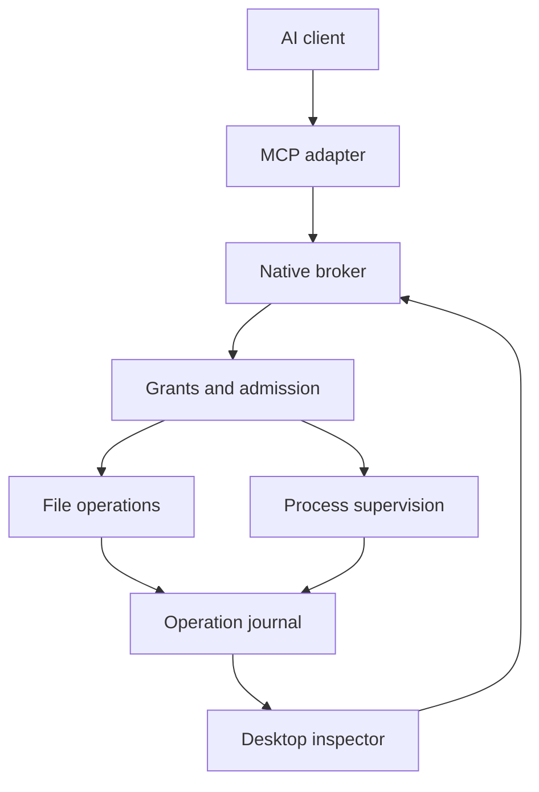

# Devagotchi audit and build foundation

Prepared for Hades on October 16, 2026. Architecture, public adoption, task graph, and internal mesh work updated October 17, 2026 UTC.

Devagotchi bridges AI and a person's workspace through an independently running local broker and a native desktop app. Its growth model represents every task as a graph, with explicit dependencies, attempts, execution ownership, and recovery evidence. Public documentation and connection contracts make the product accessible to humans and agents.

The confirmed product targets are a locally installed MCP client, a styled native command inspector, Windows/macOS/Linux, the owned repository [eonsofstupid/devagotchi](https://github.com/eonsofstupid/devagotchi), and [devagotchi.net](https://devagotchi.net). The rebuilt [public site](https://devagotchi.justsayit.chatgpt.site) supplies connection docs, an HTTP/MCP reference, and a downloadable Linux source preview. The core includes a Rust broker, Tauri/React inspector, generated contracts, and recorded Linux checks; graph/mesh execution and native Windows/macOS remain implementation work.

# Outcome and authority

The user requested an owned product that improves Desktop Commander, makes workspace activity visible in a styled app, and grows through existing architectural owners. Current priorities include publishing the website and its API/MCP connection reference, investigating recurring user complaints, and planning every task as a graph with a trusted internal mesh.

Locked product choices include Devagotchi's name, local MCP client path, native command inspector, owned repository, devagotchi.net, Windows/macOS/Linux targets, and representing every admitted task as a graph. A trusted internal mesh and authenticated runtime API/MCP are committed direction. Rust, Tauri, React, and SQLite are retained implementation choices; graph and mesh mechanisms remain proposed.

The GitHub connection again returned 404 for the supplied repository, so its contents and instructions remain uninspected and core integration is pending. The existing Devagotchi Site was reused and published as version 3. The devagotchi.net binding is registered and pending DNS validation; the verified hosted URL is available now.

## Confirmed scope and remaining integration choices

1. **Client path confirmed:** a locally installed MCP client. Devagotchi exposes an MCP server adapter to that host. Scripted stdio clients exercise the adapter; a particular desktop host still needs to be selected and tested end to end.

2. **App scope confirmed:** a styled native app showing commands, exact arguments, working directory, retained output, status, cancellation and connection health. File/search/edit capabilities remain part of the Desktop Commander improvement sequence. Screen capture, accessibility and mouse/keyboard automation have not been requested.

3. **Product destinations confirmed:** Windows, macOS and Linux; [eonsofstupid/devagotchi](https://github.com/eonsofstupid/devagotchi); [devagotchi.net](https://devagotchi.net). The published [website and reference](https://devagotchi.justsayit.chatgpt.site) are available. Repository reconciliation and custom-domain validation remain pending; native execution is Linux only.

The public website and reference service ship independently of the native installer release. The core's next packet establishes reproducible measurements and resolves sustained-admission, persistence, and contract limits. Local graph records and scheduling then extend that same foundation. Repository integration depends on inspecting its actual source; native support and named-client claims require their own acceptance evidence.

# Public website and adoption

The rebuilt [Devagotchi website](https://devagotchi.justsayit.chatgpt.site) is published as **version 3**. Product, Connect, Architecture, and Research pages explain the real Linux preview and the planned universal bridge. The existing Site identity, public audience, native UI branding foundations, and retained data bindings were reused.

| Surface | Address and availability |
|---|---|
| Product and developer guide | [Website](https://devagotchi.justsayit.chatgpt.site) and [Connect](https://devagotchi.justsayit.chatgpt.site/connect) |
| Public capability API | [GET /api/v1/capabilities](https://devagotchi.justsayit.chatgpt.site/api/v1/capabilities), anonymous read only |
| Reference topics | [GET /api/v1/reference?topic=local-tools](https://devagotchi.justsayit.chatgpt.site/api/v1/reference?topic=local-tools) |
| API description | [OpenAPI 3.1](https://devagotchi.justsayit.chatgpt.site/openapi.json) and [agent reading guide](https://devagotchi.justsayit.chatgpt.site/llms.txt) |
| Hosted MCP | https://devagotchi.justsayit.chatgpt.site/mcp, MCP 2026-07-28 with hosted OAuth |
| Source preview | [Linux source ZIP](https://devagotchi.justsayit.chatgpt.site/downloads/devagotchi-linux-source-preview.zip) and [checksum](https://devagotchi.justsayit.chatgpt.site/downloads/devagotchi-linux-source-preview.sha256) |
| Requested custom domain | devagotchi.net is registered to the Site and pending DNS validation |

The MCP catalog contains `devagotchi_get_capabilities` and `devagotchi_get_reference`. These return reference information; local execution still uses the installed broker's four operation tools. The hosted plugin is provisioned and already installed. Its tools did not surface in this chat, so an authenticated named-client tool call remains unverified.

**Publication evidence:** production build and TypeScript checks pass; 12 focused reference-handler checks pass; all 13 public GET checks return 200. The deployed source ZIP, schema, agent guide, and native screenshot match their packaged bytes. The MCP endpoint returns an OAuth challenge. The source commit is `91bb93c49eb35fa37315973666ce71dbb437a659`. The supervised preview failed to become healthy, leaving browser visual QA unverified. The complete receipt is `devagotchi/verification/website-publication.json` in the source/planning package.

The public ZIP contains 78 files, including 73 verbatim canonical files and package notices/manifests; SHA-256 `5fe3a0ff3fa763b1c1b360ff49fb8926a9df1ed30798e4675fd545739976d252`. It is a source snapshot prepared before the publication receipt. Historical raw reports, installed dependencies, binaries, and local state are omitted. The project license has not been selected.

## Domain activation

Add the following at the DNS provider for devagotchi.net, then refresh the existing Site binding. No DNS-management capability was connected for this publication.

| Type | Name | Value |
|---|---|---|
| A | devagotchi.net | 162.159.143.30 |
| A | devagotchi.net | 172.66.3.26 |
| TXT | _openai-site-verification.devagotchi.net | openai-site-verification=kKSK9bwSL11j8L-6NfakmHQyD1427JPdkZpe844OFkg |
| TXT | _cf-custom-hostname.devagotchi.net | c7d276bf-a4c0-425d-967a-c53a30527202 |

Keep connection URLs on the verified hosted origin until domain and TLS validation succeed.

# Implemented foundation and recorded checks

The source package contains a Linux execution provider, independent broker, four-tool official-SDK MCP adapter and styled native Tauri inspector. The inspector displays real command history, exact invocation details, output, cancellation and connection state. Workspaces currently shows observed directories; it does not edit grants.

| Verification | Result | Scope |
|---|---|---|
| Core module tests | 7 passed | UTF-8 boundaries, config limits, durable journal/fault handling and restart without replay |
| Real broker through MCP | 8 checks passed | Process execution, independent readers, idempotent retry/conflict, reconnect, cancellation, deadlines, overflow and crash recovery |
| MCP wire/catalog checks | 11 passed | SDK-supported initialize and modern discovery/metadata paths; no named-host certification |
| IPC/execution boundary suite | 15 grouped tests passed; no failures, errors or skips | Real Linux socket, UID, path/grant, framing, lifecycle and journal-collision cases |
| Contract generation | Passed | Fresh canonical schema/TypeScript comparison without rewriting artifacts |
| Frontend and native build | Passed | Strict TypeScript/Vite production assets and linked Linux Tauri executable |
| Native host tests | 3 passed | CLI configuration, local navigation and typed framed IPC behavior |
| Actual native WebKit app | 7 checks passed | Real IDs/arguments/output, rapid command switching with cancellation isolation, broker loss and retained history; clean teardown |

These counts describe different test units and are not a coverage score. The native UI was exercised in a virtual Linux display, with current embedded assets and no mock native calls. Running, cancelled and disconnected screens were inspected internally. The optional Playwright fixture run was blocked by an unusable test-browser download; it is not represented as passed.

The archive's devagotchi/verification directory contains historical reports, command details, tested binary hashes where recorded, and evidence limits. Those results were not rerun in this planning revision and establish no comparative performance superiority. The updated docs define the growth plan, proposed budgets and next execution guide. This remains a development foundation, with file/search/edit, terminals, onboarding, Windows/macOS execution, complete retention/audit, named-host integration and distribution still pending.

# Verified baseline

The reference is wonderwhy-er/DesktopCommanderMCP at commit **f508e524469c26f6366e17dbfd3ee5a69d112127**, dated October 14, 2026. The GitHub connector confirmed that main pointed to this commit during the inspection.

The recursive tree contained 578 entries and was not truncated. Selected source and test files were fetched through the GitHub connector. Every source copy included in the evidence archive is verified against its Git blob SHA from that tree. The archive is a partial reference snapshot, not a complete checkout.

The source package declares version 0.3.0 and Node >=22.12.0. That is the inspected package declaration, not a claim that an installed or published release was tested. The repository carries an MIT license; the reference copy retains it. See [package.json](https://github.com/wonderwhy-er/DesktopCommanderMCP/blob/f508e524469c26f6366e17dbfd3ee5a69d112127/package.json) and [LICENSE](https://github.com/wonderwhy-er/DesktopCommanderMCP/blob/f508e524469c26f6366e17dbfd3ee5a69d112127/LICENSE).

For the upstream audit, a direct Git clone failed because the environment could not connect to its GitHub network proxy; connector reads succeeded. No dependency installation, full build, full upstream test suite, live remote service, or Windows desktop run of DesktopCommanderMCP was performed. The Devagotchi implementation and its separate checks are described below.

## What the reference already does well

The inspected project already includes terminal execution, interactive process input, paginated output, file search and editing, document handling, local tool history, a file preview interface, and remote device connectivity. Its security documentation explicitly describes a trusted-client automation model.

The process layer has ordinary output limits, wait ceilings, partial-line handling, Windows command quoting fixes, and substantial process-tree cancellation logic. The remote layer has private channel use, pending-call recovery, conditional database claims, child supervision, token rotation, and logout race handling. The configuration layer has a real atomic writer.

These behaviors become regression requirements for a replacement. Adding a tray icon or translating the code into another language would not, by itself, improve the execution guarantees.

Sources: [README.md](https://github.com/wonderwhy-er/DesktopCommanderMCP/blob/f508e524469c26f6366e17dbfd3ee5a69d112127/README.md), [src/terminal-manager.ts](https://github.com/wonderwhy-er/DesktopCommanderMCP/blob/f508e524469c26f6366e17dbfd3ee5a69d112127/src/terminal-manager.ts), [src/utils/process-tree.ts](https://github.com/wonderwhy-er/DesktopCommanderMCP/blob/f508e524469c26f6366e17dbfd3ee5a69d112127/src/utils/process-tree.ts), [src/remote-device/remote-channel.ts](https://github.com/wonderwhy-er/DesktopCommanderMCP/blob/f508e524469c26f6366e17dbfd3ee5a69d112127/src/remote-device/remote-channel.ts), [src/utils/atomic-write.ts](https://github.com/wonderwhy-er/DesktopCommanderMCP/blob/f508e524469c26f6366e17dbfd3ee5a69d112127/src/utils/atomic-write.ts).

# Findings that justify the rebuild

## F01 Split UTF-8 output is corrupted

**Evidence class: reproduced in a source harness.**

The stdout and stderr listeners decode each data chunk independently with data.toString(). A stream chunk can end partway through a UTF-8 character.

The harness runs the actual TerminalManager body with a fake child process and stubbed configuration. It delivers the bytes for the euro character in two chunks. The observed output is three replacement characters, **���**, instead of **€**.

This affects the fidelity of program output, including non-English text and filenames. Use a stateful decoder or retain bytes and decode with explicit stream state. Non-UTF-8 output also needs a declared encoding policy.

Source: [src/terminal-manager.ts](https://github.com/wonderwhy-er/DesktopCommanderMCP/blob/f508e524469c26f6366e17dbfd3ee5a69d112127/src/terminal-manager.ts#L354-L423). Reproduction: audit/probes/process-output.mjs; recorded output: audit/results/process-output.json.

## F02 Default readers share one mutable output cursor

**Evidence class: reproduced behavior; a limitation for multiple consumers.**

The default read updates lastReadIndex and lastReadOpenLine on the process session itself. In the probe, the first reader receives the retained lines and the second reader receives an empty array.

This is coherent for a single consumer. It does not provide independent observation for an AI client, a terminal view, and an inspector. The replacement should accept a caller-owned cursor and return the next cursor, with no global “already read” mutation.

Explicit absolute reads already exist upstream; the finding is specifically about the default new-output cursor.

Source: [src/terminal-manager.ts](https://github.com/wonderwhy-er/DesktopCommanderMCP/blob/f508e524469c26f6366e17dbfd3ee5a69d112127/src/terminal-manager.ts#L660-L680). Reproduction: audit/probes/process-output.mjs.

## F03 A case-sensitive sibling passes the configured directory check

**Evidence class: reproduced against a real Linux filesystem using the actual validation functions.**

normalizePath lowercases every path, irrespective of filesystem case rules. With only a directory named allowed configured, a distinct sibling named ALLOWED is also accepted.

The test confirms that the directories have different inodes. It also checks two controls: an unrelated sibling is rejected, and a symlink inside the allowed directory pointing to the unrelated sibling is rejected.

This establishes a directory-guardrail correctness defect on a case-sensitive filesystem. It is not a claim of escaping an OS sandbox; upstream explicitly does not provide that sandbox.

Sources: [src/tools/filesystem.ts](https://github.com/wonderwhy-er/DesktopCommanderMCP/blob/f508e524469c26f6366e17dbfd3ee5a69d112127/src/tools/filesystem.ts#L134-L305) and [SECURITY.md](https://github.com/wonderwhy-er/DesktopCommanderMCP/blob/f508e524469c26f6366e17dbfd3ee5a69d112127/SECURITY.md#L5-L44). Reproduction: audit/probes/path-validation.mjs; results: audit/results/path-validation.json.

## F04 User text edits do not use the existing atomic writer

**Evidence class: static source finding.**

The project’s internal-state helper writes to an adjacent temporary file, syncs, renames, and serializes same-file writes inside its process. Ordinary text writes instead call fs.writeFile or fs.appendFile directly. The edit path reads content, builds a replacement, and later uses that normal write route.

The inspected write and edit schemas do not include an expected-content hash or revision that must still match at commit. A concurrent writer can therefore create a lost-update risk. No crash or concurrent-writer reproduction was run in this audit.

The replacement needs both crash-safe replacement and stale-content detection. Atomic replacement alone does not make an entire read/modify/write operation transactional.

Sources: [src/utils/atomic-write.ts](https://github.com/wonderwhy-er/DesktopCommanderMCP/blob/f508e524469c26f6366e17dbfd3ee5a69d112127/src/utils/atomic-write.ts#L24-L90), [src/utils/files/text.ts](https://github.com/wonderwhy-er/DesktopCommanderMCP/blob/f508e524469c26f6366e17dbfd3ee5a69d112127/src/utils/files/text.ts#L97-L103), [src/tools/edit.ts](https://github.com/wonderwhy-er/DesktopCommanderMCP/blob/f508e524469c26f6366e17dbfd3ee5a69d112127/src/tools/edit.ts#L144-L206), [src/tools/schemas.ts](https://github.com/wonderwhy-er/DesktopCommanderMCP/blob/f508e524469c26f6366e17dbfd3ee5a69d112127/src/tools/schemas.ts).

## F05 Process identity and terminal behavior are too weak for a persistent bridge

**Evidence class: static source finding.**

The ordinary process registries are in-memory maps keyed by OS PID. The virtual Node registry also exists in memory. TerminalManager spawns ordinary pipes, sets TERM, and appends a newline to each input. It does not allocate a PTY or Windows ConPTY in this execution path.

The start schema exposes a shell command string and wait options, but no explicit executable/argv/cwd/environment/terminal-size contract.

Client reconnection, broker restart, machine restart, and process reattachment must have separate meanings in the replacement. An OS PID must remain an implementation detail, combined with creation identity when reconciliation requires it.

Sources: [src/terminal-manager.ts](https://github.com/wonderwhy-er/DesktopCommanderMCP/blob/f508e524469c26f6366e17dbfd3ee5a69d112127/src/terminal-manager.ts#L143-L204), [src/tools/improved-process-tools.ts](https://github.com/wonderwhy-er/DesktopCommanderMCP/blob/f508e524469c26f6366e17dbfd3ee5a69d112127/src/tools/improved-process-tools.ts#L21-L23), [src/tools/schemas.ts](https://github.com/wonderwhy-er/DesktopCommanderMCP/blob/f508e524469c26f6366e17dbfd3ee5a69d112127/src/tools/schemas.ts#L27-L43).

## F06 Resource limits are inconsistent across execution modes

**Evidence class: static findings plus a bounded timing probe.**

Ordinary output has a per-session cap of 50 × 1024 × 1024 JavaScript characters. This is a string-character limit, not a measured resident-memory limit. The node:local path accumulates stdout and stderr in complete strings outside that buffer.

Verbose timing appends to an outputEvents array without a separate event limit. The source harness shows that the array continues growing after the initial wait returns: one event at return, three after two additional chunks. It does not attempt an exhaustion test.

Apply one resource policy across every provider: memory, retained bytes, spool quota, diagnostics quota, concurrency and retention. Report dropped ranges explicitly.

Sources: [src/terminal-manager.ts](https://github.com/wonderwhy-er/DesktopCommanderMCP/blob/f508e524469c26f6366e17dbfd3ee5a69d112127/src/terminal-manager.ts#L118-L145), [src/terminal-manager.ts](https://github.com/wonderwhy-er/DesktopCommanderMCP/blob/f508e524469c26f6366e17dbfd3ee5a69d112127/src/terminal-manager.ts#L354-L423), [src/tools/improved-process-tools.ts](https://github.com/wonderwhy-er/DesktopCommanderMCP/blob/f508e524469c26f6366e17dbfd3ee5a69d112127/src/tools/improved-process-tools.ts#L40-L78).

## F07 Remote recovery does not establish durable recovery of every outcome

**Evidence class: static source finding.**

The primary remote path conditionally claims an unexpired pending row. That is useful. A fallback claim method explicitly returns true on a database error, permitting execution to proceed. Its local duplicate guard is an in-memory set capped at 100 entries.

The primary path also recognizes an ambiguous claim: an executing row has no claimant identity, so it cannot determine whether this process’s lost claim response succeeded. It skips the call to avoid a duplicate side effect.

Result persistence has another boundary: updateCallResult does not verify an affected row count; on an error it attempts a failed-status write, which can also log and return on error. The completion telemetry stage means tool execution returned, not that the result is durably recoverable by the remote caller.

A replacement should distinguish execution finished, result persisted and result delivered. Arbitrary shell side effects cannot be promised exactly once simply by adding retries or a database.

Sources: [src/remote-device/remote-channel.ts](https://github.com/wonderwhy-er/DesktopCommanderMCP/blob/f508e524469c26f6366e17dbfd3ee5a69d112127/src/remote-device/remote-channel.ts#L1052-L1142), [src/remote-device/remote-channel.ts](https://github.com/wonderwhy-er/DesktopCommanderMCP/blob/f508e524469c26f6366e17dbfd3ee5a69d112127/src/remote-device/remote-channel.ts#L1397-L1481), [src/remote-device/device.ts](https://github.com/wonderwhy-er/DesktopCommanderMCP/blob/f508e524469c26f6366e17dbfd3ee5a69d112127/src/remote-device/device.ts#L589-L687).

## F08 Existing history is a recent-activity log

**Evidence class: static source finding.**

The history record contains a timestamp, tool name, arguments, output and duration. It persists a bounded recent history, which is useful. It does not contain an operation identity, authenticated principal, workspace grant, authorization decision, resource revision or committed outcome identity.

The normal server path records results before later feedback annotations. A handler that escapes into the outer exception catch does not pass through the normal history append. Arguments are retained without a general redaction step in that logger.

The replacement should have an authoritative operation journal and a separately managed output cache. Capture admitted work, denied work, failures, cancellations and verification with the same correlation identity.

Sources: [src/utils/toolHistory.ts](https://github.com/wonderwhy-er/DesktopCommanderMCP/blob/f508e524469c26f6366e17dbfd3ee5a69d112127/src/utils/toolHistory.ts#L6-L80), [src/utils/toolHistory.ts](https://github.com/wonderwhy-er/DesktopCommanderMCP/blob/f508e524469c26f6366e17dbfd3ee5a69d112127/src/utils/toolHistory.ts#L269-L291), [src/server.ts](https://github.com/wonderwhy-er/DesktopCommanderMCP/blob/f508e524469c26f6366e17dbfd3ee5a69d112127/src/server.ts#L1431-L1546).

## F09 The security model is a product choice that must be explicit

**Evidence class: documented and source-verified behavior.**

Upstream expressly assumes the connected client is trusted. Its directory lists and command blocklists are guardrails. Its documentation says terminal commands can access outside allowedDirectories. Those facts are not undisclosed vulnerabilities.

Configuration can modify allowedDirectories and blockedCommands. An empty allowed-directory list means unrestricted file access, and the directory-loading helper returns an empty list on error. The replacement can choose a different policy: required policy-load failure blocks admission, and widening authority belongs to an operator-controlled path.

A permitted arbitrary executable still has the OS account’s authority unless an actual OS isolation boundary is implemented and tested. A Rust rewrite, workspace selection, Tauri capability file, or command denylist does not provide that containment.

Sources: [SECURITY.md](https://github.com/wonderwhy-er/DesktopCommanderMCP/blob/f508e524469c26f6366e17dbfd3ee5a69d112127/SECURITY.md#L5-L44), [src/tools/filesystem.ts](https://github.com/wonderwhy-er/DesktopCommanderMCP/blob/f508e524469c26f6366e17dbfd3ee5a69d112127/src/tools/filesystem.ts#L111-L136), [src/tools/filesystem.ts](https://github.com/wonderwhy-er/DesktopCommanderMCP/blob/f508e524469c26f6366e17dbfd3ee5a69d112127/src/tools/filesystem.ts#L290-L305), [src/config-field-definitions.ts](https://github.com/wonderwhy-er/DesktopCommanderMCP/blob/f508e524469c26f6366e17dbfd3ee5a69d112127/src/config-field-definitions.ts#L9-L20).

## F10 The production remote service is outside the inspected boundary

The tree does not contain implementations of the hosted /api/mcp-info, /device/start and /device/poll endpoints or the SQL policies and triggers that govern remote call tables.

The client demonstrates PKCE construction, private channel use and token persistence. It does not establish hosted enforcement, account isolation, production retention or revocation behavior. Tokens are saved as JSON with POSIX mode 0600; the README explicitly notes that a custom owner-only Windows ACL is not set.

To audit or rebuild remote access, its server, authorization policy, routing and retention must become inspectable deliverables.

Sources: [src/remote-device/device-authenticator.ts](https://github.com/wonderwhy-er/DesktopCommanderMCP/blob/f508e524469c26f6366e17dbfd3ee5a69d112127/src/remote-device/device-authenticator.ts#L80-L107), [src/remote-device/device.ts](https://github.com/wonderwhy-er/DesktopCommanderMCP/blob/f508e524469c26f6366e17dbfd3ee5a69d112127/src/remote-device/device.ts#L465-L533), [src/remote-device/README.md](https://github.com/wonderwhy-er/DesktopCommanderMCP/blob/f508e524469c26f6366e17dbfd3ee5a69d112127/src/remote-device/README.md#L38-L44).

# System boundaries

A single user installation contains a broker, a local MCP adapter and a native inspector. The broker owns admitted work independently of either observer. File providers shown below are planned; the current implemented provider supervises ordinary Linux processes.



| Boundary | Owns | Current foundation and remaining work |
|---|---|---|
| Contracts | Requests, results, errors and operation states | Canonical Rust DTOs generate JSON Schema and desktop TypeScript; domain bounds remain enforced in Rust |
| Broker | OS-user binding, configured grants, admission and operation lifecycle | Independently running Rust process; application-specific caller identities and grant-management UI remain future work |
| Providers | Native work and process ownership | Linux pipes and inherited process groups implemented; Windows, macOS, files and PTY providers still required |
| Journal | Durable operation transitions and retained output | Local SQLite with WAL and synchronous FULL; logical retention bounds, incomplete recovery marked unknown |
| MCP adapter | Protocol negotiation and typed tool mapping | Official rmcp 3.5.1; four stdio tools; scripted protocol and execution checks; named host integration pending |
| Desktop inspector | Activity, exact command details, output and cancellation | Tauri 2 with React/TypeScript; real broker calls; observed-directory and connection views; onboarding and grants pending |

The broker must outlive client adapters and the inspector when continued work is intended. Closing a UI window is not a request to kill a job. An explicit stop action controls broker shutdown.

Use a protected named pipe on Windows or a protected Unix-domain socket on platforms that support it. Bind the connection to an authenticated local principal and grant. Caller-supplied subject IDs, workspace IDs or operation IDs are not proof of authority. Protection against other applications running as the same OS user must be documented; a per-user socket alone does not isolate mutually untrusted software under that user.

The first client uses local stdio and private IPC. A separately authenticated remote adapter is deferred unless requested. A future relay would still need local grant enforcement and its own service-side evidence; connectivity alone must never authorize execution.

# Implementation choices and remaining contracts

## Native runtime and UI

The broker is implemented in Rust using Tokio. The MCP adapter pins the official Rust SDK to rmcp 3.5.1 and exposes operation_start, operation_get, operation_read and operation_cancel. Scripted clients verify both legacy initialize with protocol 2025-11-25 and modern discovery/per-request metadata with 2026-07-28. These checks do not certify a named desktop host.

The inspector uses Tauri 2.12.4 with React and TypeScript. Its native host exposes five explicitly registered local-window commands and validates responses against the broker DTOs. Navigation, new-window and content-security policies limit the webview surface. The broker separately validates its private IPC peer and configured executable grants; frontend capabilities do not sandbox child processes.

Sources: [official Rust MCP SDK](https://github.com/modelcontextprotocol/rust-sdk), [Tauri IPC](https://v2.tauri.app/concept/inter-process-communication/), [Tauri capabilities](https://v2.tauri.app/security/capabilities/).

A TypeScript implementation could also fix the identified defects. Language selection should follow the owned OS boundary and maintainability needs, without treating a rewrite as evidence of correctness.

## Contract authority

Define request, event, result and error schemas together. Generate the transport catalog and UI-facing types from the chosen authority. Backend validation must remain real runtime validation.

The implemented authority is src/contracts.rs. An export-only Rust root produces one JSON Schema graph; json-schema-to-typescript generates the desktop DTOs. The generation check compares fresh schema and TypeScript without rewriting artifacts. It covers optional/null shapes, tagged unions and lossless base64 output; numeric domain limits remain runtime checks. Windows filesystem behavior still requires its own native provider and tests.

Unsupported parameters must fail before execution. Do not execute a partially understood request and append a warning afterward. Return an error code, affected field and supported shape. A failed capability should remain unavailable until fixed.

As inspected on October 16, 2026, the MCP specification is 2026-07-28. Devagotchi currently uses stdio through the pinned SDK; its operation lifetime remains independent of protocol request cancellation. Unsupported protocol or request shapes fail explicitly. Streamable HTTP and optional extensions are not implemented merely because the specification describes them.

Sources: [current MCP specification](https://modelcontextprotocol.io/specification/2026-07-28), [transports](https://modelcontextprotocol.io/specification/2026-07-28/basic/transports), [tools](https://modelcontextprotocol.io/specification/2026-07-28/server/tools).

## Persistence

The current journal uses local SQLite with WAL and synchronous FULL, checked during startup. It stores exact operation requests and retained output bytes. Admission commits before process launch, and critical persistence failure becomes visible unknown state and blocks new execution. Logical output, frame and operation counts are bounded; a strict physical disk quota, retention/pruning flow and migration policy remain release work. No power-loss durability claim has been tested.

The journal should be independently useful for inspection and recovery. Future agent memory or indexing can consume it without becoming necessary for file reads or process execution.

Sources: [SQLite WAL](https://www.sqlite.org/wal.html) and [SQLite synchronous behavior](https://www.sqlite.org/pragma.html#pragma_synchronous).

# Execution contract and scope

## Separate pipe execution from interactive terminals

Implemented pipe execution accepts an exact executable, argument vector, canonical working directory and deadline. The executable must appear in the operator's startup grant; inherited environment is cleared and stdin is closed. An interpreter grant authorizes that interpreter's behavior as the OS user. A checked working directory does not contain filesystem or network effects. Configurable environments, interactive input and PTY mode require explicit future contracts.

Interactive mode allocates a real terminal and supports terminal dimensions, resize, raw input, newline control, EOF and interrupt. On Windows, ConPTY provides the pseudoconsole facility. Use Windows Job Objects where appropriate for owned-process management, and test breakaway and nesting behavior before making containment or cancellation claims.

Sources: [Windows pseudoconsole sessions](https://learn.microsoft.com/en-us/windows/console/creating-a-pseudoconsole-session), [Windows Job Objects](https://learn.microsoft.com/en-us/windows/win32/procthread/job-objects).

A prompt-looking output string can support a waiting-for-input hint. It cannot establish that a process completed. An exit event establishes process termination; a separate postcondition check establishes whether the user’s intended change occurred.

## Stable jobs and independent readers

The implementation assigns a UUID operation ID and persists admission before launch. Retry keys are scoped to the current broker state/configuration and request digest; there is one configured workspace and one OS-user trust domain. Startup never recovers a process by remembered PID: unfinished admissions become unknown without replay. Per-client principals, session identities and stronger reconnectable native ownership are future extensions.

Implemented output frames have a monotonically increasing sequence, stream identity, exact bytes encoded as base64, and incrementally decoded text. Independent readers specify their own cursor and receive gap and completeness metadata. Per-frame timestamps and byte offsets are not part of the current DTO. A future PTY produces a combined terminal stream; it must not pretend to preserve separate stdout/stderr when the platform does not.

The current core caps retained raw output bytes and frame count, response bytes, operation count, concurrent jobs and IPC connections. The inspector also caps displayed frames and text. Overflow is explicit and pipes continue draining. Physical disk quota enforcement, pruning and diagnostic-retention policies remain separate release requirements.

Input requires a writer lease or a serialized queue. A successful write acknowledgment means bytes were accepted by the input channel, not that the child interpreted or completed the command. Unstructured REPL output cannot reliably be assigned to concurrent semantic requests without an application protocol.

## Time and failure states

| Concept | Meaning |
|---|---|
| Wait budget | How long the current tool invocation waits before returning a handle |
| Execution deadline | Whether and when the broker requests cancellation of the job |
| Client disconnected | The observer left; the broker may still own a running job |
| Broker failed | The executor’s state must be reconciled after restart |
| Execution finished | The process or operation returned |
| Effect verified | A relevant postcondition has been checked |
| Result persisted | The result has a durable local record |
| Result delivered | A caller received an acknowledged response |
| Outcome unknown | Effects may exist but cannot yet be established |

Persist admission before starting a side effect. Persist the outcome before acknowledging a durable result. A crash between an external effect and the next journal write is still an ambiguity; preserve that fact and reconcile it.

The implemented retry key is coupled to the request and configuration digest in one broker journal. An identical retry returns the recorded operation; changed content returns a conflict. It does not authenticate a particular MCP application or provide exactly-once arbitrary side effects. Extending to multiple callers/workspaces requires explicit namespace and authority binding.

A process can survive a client disconnect while the broker remains alive. The first version should make no promise that arbitrary processes survive broker failure or reboot. On restart, report interrupted or unknown state unless the implementation can actually reconnect and verify the owned resource.

# File and policy contract

Resolve access against the resource actually opened, including symlinks, Windows reparse points, parent directory replacement and missing destinations. Universal path lowercasing is prohibited.

File modification follows an explicit proposal and commit flow:

1. Read the file and capture its identity, content digest and relevant metadata.

2. Compute a deterministic proposed change and expose the diff.

3. Verify the active workspace grant and expected revision at the write boundary.

4. Serialize broker writes to the resource.

5. Commit through a platform-appropriate atomic replacement and preserve required metadata, including Windows ACLs where applicable.

6. Re-read or otherwise verify the committed revision and record the result.

A per-process lock plus hash check plus rename does not guarantee atomic compare-and-swap against arbitrary external writers. Prove a stronger OS locking strategy on the selected filesystem, or explicitly use an isolated working copy and a controlled integration step. If a safe commit cannot be established, return a conflict or an unverified outcome; do not silently claim a transaction.

For the initial phase, handle single-file edits. A multi-file patch is not automatically atomic across all paths. Cross-filesystem moves and network shares need their own supported behavior.

Fuzzy search can suggest a candidate match. Applying a mutation requires an unambiguous target and current revision. The user should be able to grant a bounded workspace session once; repeated routine operations inside that grant should not require repetitive approval. Grant widening, destructive operations outside the grant and other genuinely new authority need a concrete reviewable request.

The current journal stores exact requests, operation state and retained output under private local permissions; a complete correlated authority/denial event chain is still required. The broker and inspector send no telemetry. MCP hosts receive tool results and may forward them to their model or services, so a locally installed client is not a guarantee that all tool data stays on the device.

# Operator inspector

The current inspector implements Activity, command details, live retained output, cancellation, observed directories and connection health. It distinguishes unconfigured, disconnected, empty and incomplete states without fabricated activity. As the broker gains richer evidence, the complete product should answer:

- Which client requested the operation, and under which workspace and grant?

- Which workspace and execution context did the work use?

- Which inputs, resources and content revisions were used?

- Which checks passed, failed or blocked execution?

- Which bytes or processes changed, and what verified that change?

- What did the operator authorize?

- Did execution finish, was its result stored, and did the caller receive it?

Workspaces with editable grants, client sessions, approval history and complete evidence timelines are future views that require corresponding broker contracts. The present Workspaces view reports directories observed in the current operation page and does not pretend to manage grants.

A timeline can contain request received, authorization evaluated, operation admitted, handler started, output emitted, cancellation requested, execution finished, postcondition checked, result persisted and result delivered. These are distinct events, not UI labels inferred from an assistant’s explanation.

Replay means viewing an existing event sequence. Retry creates a new linked attempt after validating current conditions. Neither feature implies reconstructing an arbitrary program’s memory or undoing external side effects.

The current inspector renders captured output as escaped React text and makes control characters visible. It does not interpret HTML or terminal escape sequences. A future interactive terminal needs a bounded parser and explicit input ownership.

If actual Windows application control is selected, add a dedicated provider using UI Automation for accessible elements, plus separately granted screen capture and input where needed. UI Automation exposes an accessibility tree and control patterns; actual coverage depends on the application’s providers. Test the named target applications rather than claiming universal desktop control.

Source: [Microsoft UI Automation](https://learn.microsoft.com/en-us/windows/win32/winauto/entry-uiauto-win32).

# Working repository organization

The intended destination is eonsofstupid/devagotchi. These paths exist in the isolated implementation supplied with this foundation; they have not been compared with or pushed to the inaccessible GitHub repository.

| Path | Responsibility |
|---|---|
| src/contracts.rs | Canonical requests, results, errors and states |
| src/execution.rs | Linux job supervision, grants, output, limits and cancellation |
| src/journal.rs | Durable admission, output and recovery |
| src/ipc.rs | Private local transport, peer checks, framing and instance ownership |
| src/bin/bridge-broker.rs | Independent broker startup, dispatch and shutdown |
| src/bin/bridge-mcp.rs | Official SDK stdio adapter and four typed tools |
| src/bin/export-contracts.rs | Canonical JSON Schema exporter |
| scripts/generate-contracts.cjs | Schema/TypeScript generation and drift check |
| schemas/broker-contracts.schema.json | Generated schema graph |
| apps/desktop/src/ | Native inspector's React/TypeScript presentation |
| apps/desktop/src-tauri/ | Tauri host, narrow permissions and typed broker calls |
| tests/ | Process, protocol, IPC-boundary and native UI harnesses |
| verification/ | Recorded checks, versions and limitations |
| docs/product-and-platform-plan.md | Architecture, scope, ownership, decisions, phases and traceability |
| docs/performance-and-experience-spec.md | Workloads, metric definitions, proposed budgets and native experience acceptance |
| docs/implementation-guide.md | Standalone next execution packet, validation and recovery |

Colocate the types, handlers and tests for a feature. Split crates only at real dependency or lifecycle boundaries. Keep platform functions out of presentation components. Do not build generic provider registries, plugin marketplaces or distributed memory services before a concrete capability requires them.

# Task graphs and trusted internal mesh

Every admitted task being a graph is now locked product direction. The proposed model uses an immutable definition revision, a run with resolved inputs and authority, bounded dependency nodes, and recorded attempts that reference existing broker operations. A single command is a one-node graph. Task scheduling and receipts extend the current broker and SQLite journal.

Execution dependencies form a DAG. Provenance and device topology are separate relationships; a cyclic mesh does not permit a cyclic dependency plan. Readiness requires defined predecessor outcomes and explicit input bindings. Unknown outcomes cannot satisfy dependencies, and transport redelivery cannot silently create a new attempt.

The first mesh has one explicit task owner and two enrolled brokers. Each target checks its current grants and owns local settlement. Dispatch names the principal, device, run, node, attempt, and authority epoch. Durable delivery and reconciliation extend the existing journal. Cancellation intent, acceptance, native settlement, output completion, and result certainty remain distinct during partitions. There is no silent device fallback or promise of exactly-once arbitrary side effects.

These mechanisms are design proposals. The complete contract is `devagotchi/docs/task-graph-and-mesh-contract.md`; the [public architecture page](https://devagotchi.justsayit.chatgpt.site/architecture) presents the model interactively with illustrative data. Local graph records and scheduling precede authenticated runtime adapters and the two-broker mesh packet.

## Recurring user experience requirements

The [research page](https://devagotchi.justsayit.chatgpt.site/research) and [primary-source ledger](https://devagotchi.justsayit.chatgpt.site/reference/desktop-commander-user-evidence.md) identify nine recurring themes, with individual reports, corrections, fix evidence, and planned acceptance cases. This qualitative sample establishes requirements; it does not measure population frequency or Devagotchi's comparative performance.

The key requirements are predictable startup, stable operation ownership, native environment handling, faithful bounded output, completed resource cleanup, accurate remote readiness, explicit device/conversation scope, and operator-controlled integration. The ledger preserves material corrections: #645's closure does not establish every startup issue fixed; #633 has positive recovery-fix evidence; #838 was a resolved incident; #586's reporter confirmed improved routing; #722 asks for conversation scope separately. Requirements feed the existing execution, transport, policy, journal, and UI owners.

# Scale and growth review

Planning revision: **October 17, 2026 UTC**. The user's governing requirement is to extend existing responsibilities before adding boundaries, plan for sustained growth, and demonstrate real performance and workstation-experience improvements on Windows, macOS, and Linux.

The scale review preserves the recovered foundation and historical reports. Before documentation changes, all 77 recorded source-manifest entries matched the baseline archive, SHA-256 **075a259e66f50168c84989d8cedb81c1debadd08e950bf2f3abb468c4e2b7987**. The website is a separate implementation surface with separate checks. This revision adds no comparative benchmark, core feature implementation, or Windows/macOS certification.

## Concrete limits found in the existing source

| Finding | Observed behavior | Growth implication |
|---|---|---|
| Cumulative admission cap | Broker::start checks all retained operations; default limit 64, separate active concurrency default 4 | Completed history eventually prevents new work; raising a constant does not provide sustained operation |
| Eager history recovery | Journal::load loads every operation and its retained frames | Startup and memory depend on all retained output |
| Journal and registry coupling | Each output frame is at most 1024 raw bytes; append commits synchronously under the shared registry mutex | Noisy output and storage stalls can delay control and reads; the cost needs measurement |
| Repeated history work | Each list call sorts the full retained history under that lock | Small pages still perform history-sized work |
| Observation polling | Linux uses a 20 ms fallback timer; /proc group scans occur after root exit and during cancellation settlement | Root-alive and root-exited workloads require separate CPU/latency measurements |
| UI polling and fan-out | Lists poll at 3 s, active output at 1 s; Workspaces fetches up to 32 command details through four workers | The app has repeated acquisition and delayed freshness to address in its existing data owner |
| Dependency coupling | Contracts import schema support through rmcp; native host depends on the root crate | Feature gating and direct schema dependencies should precede new crate boundaries |
| Retry identity tied to tuning | Retention and concurrency settings enter config_identity and request digest | Changing capacity can turn an unchanged retry into a conflict |
| Persistence tied to wire shape | Journal stores strict OperationView JSON directly | Required field changes need migration, not just a generated TypeScript update |
| Development setup | One startup workspace/grant set, explicit socket configuration, cleared environment, closed stdin, five-minute maximum deadline | A usable workstation product needs deliberate setup, environment, long-lived job, and terminal contracts |

These are static observations from src/execution.rs, src/journal.rs, src/contracts.rs, src/ipc.rs, the Cargo manifests, useInspector.ts, and App.tsx. They identify plausible improvement work, not measured performance bottlenecks. The complete source-linked analysis is in the updated package.

## Extend the owners already present

Keep one broker and authoritative local journal per installation, one canonical contract source, the existing MCP adapter, and the native inspector. Task records and dependency scheduling extend the existing broker and journal. A mesh links installation owners; it does not create a broker per task or a globally writable journal.

| Owner | Extend it with | Avoid duplicating |
|---|---|---|
| Existing Broker/Shared lifecycle | Sustained admission, bounded task scheduling, typed operations, workspace authority | Another operation engine per capability or OS |
| Existing execution code | Narrow Windows/macOS/Linux process and terminal mechanisms | Three copies of admission, retry, retention, and recovery |
| Existing journal | Versioned operation/task/attempt records, migrations, bounded writer, paged history and resumption | Audit database, event service, or storage daemon |
| Existing contracts and generator | Versioned results/events, workspace references, explicit certainty/settlement, native resource representation | Hand-authored competing DTOs |
| Existing IPC | Shared typed client methods, compatibility, bounded observation/resume, native endpoints | A separate transport server merely for UI updates |
| Existing inspector hook/client | One bounded operation/workspace cache and subscription owner | Independent per-screen polling and reconstruction |
| Existing native host | Folder selection, connection setup, broker lifecycle and installation integration | UI-owned jobs or frontend-only grants |
| Existing components/styles | Extract and reuse current views, primitives, and tokens | An uninspected design system or another global styling package |
| Existing broker, policy, typed client, and journal | Authenticated runtime adapters and explicit peer dispatch with durable reconciliation | A second execution owner or authority supplied by a transport session |

The proposed code organization moves the current broker policy/lifecycle into src/broker.rs within the same crate, leaving process orchestration in execution and native mechanics in its platform modules. This relocates the existing owner; it does not establish a second broker. A file module becomes justified when the real file capability arrives and reuses the same admission, authority, journal, and long-operation contracts.

Every new boundary proposal must identify the existing owner inspected, why extension is inadequate, authoritative state, code it replaces, dependencies/failure behavior, and an acceptance test. Feature gating and local module reuse come before new crates. Other ecosystem repositories must be inspected before assuming their APIs or adopting them.

## Contracts to settle before feature expansion

**Persistence and retries.** Separate wire versions from stored-record versions. Preserve legacy retry evidence and distinguish semantic request changes from retention/concurrency tuning. Detailed history expiry must never silently make an old retry execute again. The proposed retry-context approach has an explicit validity window and expiry response. The broker must validate retry contexts, define restart/clock-change rules, and fence incompatible old clients/writers before reclaiming evidence. Test old-version access to migrated state so discarded history cannot become a fresh execution.

**Output and control.** Keep a bounded journal worker inside the journal owner, with bounded commits and control priority. Do not hold the registry lock while waiting for SQLite. Do not publish a durable output sequence before commit. Cancellation acknowledgement and verified resource settlement are separate. Terminal completion orders after the required output evidence or records incompleteness. If buffering can discard a middle range, add durable gap evidence, cursor rules through holes, and UTF-8 behavior across missing bytes; current prefix-eviction handling alone is insufficient.

**Truthful state.** In the current code, Unknown can appear while active cleanup is still underway. A future event consumer must distinguish result certainty, resource settlement, and output completeness instead of treating one “done” label as proof that everything stopped.

**Live observation.** Use a snapshot plus committed change watermark; retain separate per-operation output cursors. Coalesce output-available notifications and fetch bounded ranges through the current read contract. Slow subscribers get bounded queues and explicit resync/gap behavior. Subscription capacity cannot consume all capacity needed for ordinary and cancellation requests.

**Workspace authority.** The broker owns workspace/grant records. A folder picker supplies a candidate; it does not independently authorize execution. Current protection is scoped to the OS user. Per-client authority cannot be established by a client name, hidden MCP tool, or approved boolean. Queued work pins its environment/profile, uses separate queue/execution budgets, and revalidates authority before dispatch/commit. Test revoke/remove/expire/cancel between admission and dispatch.

**Files and terminals.** Cheap bounded file queries remain simple; long searches and changes reuse existing operation ownership. Use typed file results rather than fake process fields. Define native path identity, expected revisions, commit/recovery, metadata, and actual conflict guarantees. Terminal mode uses PTY/ConPTY with explicit input ownership; a pipe is not a substitute.

Tokio documents separating blocking work from async execution, while SQLite WAL still permits one writer at a time. These support evaluating a bounded writer within the existing persistence owner, without proving that a particular batch size will be faster. Sources: [Tokio](https://tokio.rs/tokio/topics/bridging), [SQLite WAL](https://www.sqlite.org/wal.html).

## Performance evidence and proposed budgets

Compare the frozen Devagotchi foundation, a candidate release build, and a reproducible pinned full Desktop Commander build on the same hardware, OS, semantics, durability/retention, and workload. The saved upstream partial snapshot is not sufficient for a full-server benchmark. Record backend and complete-product process-family costs separately.

The workload matrix covers 1/4/8/32 jobs, independent and slow readers, 1 GiB mixed output, history through 100,000 records where supported, 100,000-file workspaces with a separate million-file stress tier, overload, storage failure, native UI navigation, sleep/restart, file conflicts, terminals, and sustained soak runs. Unsupported tiers remain unsupported rather than receiving invented timings.

| User-facing metric | Proposed budget, subject to G0 baseline |
|---|---|
| Durable admission and bounded history/query response | p95 ≤100 ms, p99 ≤250 ms under the defined reference loads |
| Visible live output | p95 ≤150 ms normal, ≤250 ms mixed load |
| Cancellation intent acknowledged | p95 ≤100 ms, p99 ≤250 ms under mixed output/control load |
| Declared owned fixture resources settled | p95 ≤1 s, p99 ≤2 s; uncertainty remains a failed or unsupported result |
| Cached selection/input feedback | p95 ≤100 ms; uncached command detail ≤250 ms |
| Broker ready with 100,000 metadata records | p95 ≤2 s, with cold history/output paged |
| Quiet observation | No periodic output/history polling when subscribed data does not change |
| Sustained operation | Memory, disk, descriptors, queues, and control latency remain within declared bounds |

**These targets are proposed; none has been achieved by a reported benchmark.** The full specification also defines hardware tiers, payload/CPU/memory budgets, failure accounting, timing calibration, workload settings, and repetition. At least 1000 latency observations per condition are required before reporting p99, with independent runs and uncertainty.

A proposed material-gain gate is at least 20% improvement in a predeclared user-facing latency or resource metric beyond run-to-run variation, while protecting correctness and secondary budgets. An essential correctness or capacity improvement can be justified on its own merits; it must not be relabelled a speed win. Count every attempted request; unexpected rejection/timeout fails supported-load acceptance. Predeclare each narrow packet's applicable absolute budgets and protected metrics, while keeping unrelated baseline misses visible as phase/release debt.

## Native workstation behavior

| Platform | Native work that must be implemented/certified | User workflow that earns support |
|---|---|---|
| Windows | Explicit executable/argument encoding, owned Job Objects, ConPTY, protected named pipes, reparse/sharing/replacement behavior, session lifecycle | Install, connect host, run exact arguments, cancel associated children, resize a terminal, handle busy files, reopen work, update |
| macOS | Darwin process/PTY observation, Unix peer credentials, TCC attribution, APFS path/metadata behavior, Finder/host and sleep lifecycle | Launch from Finder and host, select accessible workspace, recover from permission denial, cancel declared scope, resume observation after sleep |
| Linux | Improve current identity/observation path, qualify IPC runtime placement and filesystem behavior, PTY, selected desktop/session/runtime conditions | Run and reconnect through the actual desktop app, cancel after parent exit, retain bounded output, handle logout/sleep and chosen Wayland/X11 environments |

Shared policy remains in the broker. Windows Job Objects have membership/breakaway rules; Unix groups do not guarantee arbitrary-descendant containment. Pidfds can improve Linux root observation but do not independently solve descendant ownership. macOS mandatory access controls apply independently of App Sandbox. Sources: [Job Objects](https://learn.microsoft.com/en-us/windows/win32/procthread/job-objects), [ConPTY](https://learn.microsoft.com/en-us/windows/console/creating-a-pseudoconsole-session), [pidfd_open](https://man7.org/linux/man-pages/man2/pidfd_open.2.html), [Apple permissions](https://developer.apple.com/forums/thread/678819), [Darwin setsid](https://developer.apple.com/library/archive/documentation/System/Conceptual/ManPages_iPhoneOS/man2/setsid.2.html).

Close window, quit inspector, stop broker, disconnect MCP, sleep, log out, crash, and reboot are separate events. The product needs an explicit outcome for each. Screen/input automation and WSL-specific integration remain deferred, rather than being implied by command visibility.

## Reconciled execution sequence

G0–G5 replace the earlier generic Phase 0–5 roadmap.

| Phase | Concrete outcome | Required exit |
|---|---|---|
| G0 — Reconcile and measure | Inspect the actual repo when accessible; freeze inputs, ownership, metric definitions and semantic choices; establish reproducible baseline | Source-bound report with actual results/blocked runs and one next optimization packet |
| G1 — Sustained foundation | Versioned persistence/retry migration, bounded journal/history, shared typed IPC, inspector cache/observation, native seams and dependency gating | Correctness retained, growth limits resolved or measured, migration and performance evidence |
| G2 — Three-OS ordinary work | Windows/macOS implementations plus Linux certification, native setup, workspace identity, environments/lifecycle, named MCP host | Actual app and host complete the same ordinary-command journey on each OS |
| G3 — Workspace files | Bounded read/list/search and single-file proposal/commit/recovery; real workspace/grant views | Large-workspace, native path/revision/metadata/failure and usable conflict-flow gates |
| G4 — Interactive experience | PTY/ConPTY, explicit writer ownership, terminal renderer, native navigation/accessibility polish | Real terminal semantics and responsiveness on all target OSes |
| G5 — Release and support | Install/update/uninstall, migration/rollback, signing/provenance, clean-machine setup, support matrix | Distribution evidence and published support/performance claims that match results |

Native design begins in G0 and its seams are established in G1. Graph records and local ordinary-process scheduling can proceed after their persistence and ownership prerequisites, without waiting for all future file and terminal work. Windows/macOS providers, journal changes, and UI work can proceed in parallel once their contracts are fixed. Authenticated runtime access and a two-broker mesh have separate acceptance packets. Website/reference publication is immediate work outside G5.

## Decision register and traceability

Status describes the decision rather than delivery. LOCKED is user direction; COMMITTED is retained scope/ownership; PROPOSED needs evidence; DECISION_REQUIRED blocks its named gate; DEFERRED is outside current execution; REJECTED is disallowed.

| Decisions | Status | Owner and destination |
|---|---|---|
| Product destinations, local MCP host, styled app, three OSes; extend existing responsibilities and demonstrate improvement | LOCKED | User direction; entire plan |
| One broker/journal/contracts/adapter/inspector; preserve audit and correctness evidence | COMMITTED | Existing architecture owners; G0–G5 |
| File/search/edit and interactive execution needed for useful replacement | COMMITTED, implementation pending | Broker/files/execution/UI; G3/G4 |
| Bounded writer/history, resumable observation, narrow native modules and proposed budgets | PROPOSED | Core/UI/benchmark owners; G0/G1 |
| Named MCP host | DECISION_REQUIRED before host certification | Product/integration owner; G2 |
| OS/architecture/filesystem/distribution matrix and native test access | DECISION_REQUIRED before native certification | Release owner; G0/G2 |
| Retry expiry, overflow/durability, sleep deadlines, queue and trust semantics | DECISION_REQUIRED before affected implementation | Core/native owners; G0/G1/G2 |
| Every task represented as a graph | LOCKED, runtime pending | Broker/contracts/journal/inspector; local graph packets |
| Trusted internal mesh and authenticated runtime API/MCP | COMMITTED direction; mechanisms PROPOSED | Existing transport/policy/broker/journal; explicit two-broker qualification |
| Immediate website and read-only public API/MCP reference | AUTHORIZED; see publication record | Existing Site identity and reference adapter |
| Autonomous fleet scheduling, marketplace, memory, other uninspected ecosystems, WSL-specific integration, screen/input control | DEFERRED | Reopen for a named user workflow |
| Per-tool/OS duplicate services, path lowercasing, pretend sandboxing, automatic unknown replay, unmeasured speed/support claims | REJECTED | All implementation and release reviews |

| Requirement source | Existing owner to extend | Verification destination |
|---|---|---|
| Latest scale/growth direction | Architecture/core/UI | G0 owner inventory; W01–W15 and B01–B14 |
| F01/F02 output correctness | Execution/contracts/journal | Independent byte/cursor regressions under load and reconnect |
| F05/F07 identity and recovery | Broker/journal | Durable admission, lost response, legacy retry, unknown/settlement cases |
| F06 and new history/journal findings | Admission/output/journal | Capacity, physical budgets, cold reopen, sustained load and control tails |
| F03/F04/F09 workspace/files | Workspace/files and current policy/journal | Native path/object, grant, revision, commit, conflict and interruption matrix |
| F08 inspectable evidence | Journal/inspector | Correlated denied/failed/admitted/completed/unknown outcomes |
| Native app and three-platform user direction | Existing host/UI/native mechanisms | Actual install/host/workspace/command/recovery journeys |
| F10 hosted-service scope and requested mesh | Planned authenticated runtime adapter; target broker remains authoritative | Service-side source, grants, explicit targets, lost receipts, partitions, fencing and revocation |
| Every task is a graph | Existing broker, contracts, journal and inspector | Bounded DAGs, input bindings, attempts, cancellation and honest unknown results |
| Recurring Desktop Commander reports | Existing process, output, workspace, connection and consent owners | Primary-source ledger mapped to planned acceptance cases |

## Standalone execution handoff

The complete deliverable is in the [updated source and planning package](library-file:libfile_8afde938b49c8191b50ceaa2760a7454):

- **docs/product-and-platform-plan.md** owns architecture, scope, responsibility placement, decisions, phases and traceability.

- **docs/performance-and-experience-spec.md** owns workload/metric definitions, proposed budgets, native acceptance and reporting.

- **docs/implementation-guide.md** gives a new implementer the publication, G0, local graph, runtime connection, and two-broker mesh packets, with existing owners, ordered changes, acceptance, and recovery.

- **docs/task-graph-and-mesh-contract.md** owns proposed records, local scheduling and mesh delivery/authority/failure semantics.

- **docs/desktop-commander-user-evidence.md** preserves primary reports, fixes, corrections and planned acceptance cases.

- **verification/website-publication.json** records actual website/source identity, HTTP/MCP checks and remaining domain/client/visual limits.

The core's next execution packet is G0: reconcile source, settle performance-affecting contracts, and establish a reproducible baseline. Each implementation change must name the existing owner, primary metric, protected invariants, acceptance case, and rollback. The new graph and mesh contract extends that sequence; it does not bypass native or distributed-failure qualification.

## Reproduce the supplied audit

Use Node 24 or newer with node:module stripTypeScriptTypes available. The path fixture requires a case-sensitive filesystem and permission to create a symlink.

```bash
node audit/probes/process-output.mjs
node audit/probes/path-validation.mjs
```

The process harness substitutes a fake child process and configuration. The path harness substitutes configuration, telemetry and timeout plumbing while using real filesystem operations. Neither command builds or starts the complete upstream MCP server.

# Current gate

The architecture and growth plan now includes task graphs, trusted internal mesh, public adoption, and a primary-source complaint ledger. Product core source and historical test evidence are preserved. The public website/reference service has its own implementation and publication record. Comparative performance, Windows/macOS support, runtime HTTP, graph execution, and mesh execution remain unproved or unimplemented as stated in their respective sections.

The core's next gate is G0: source reconciliation, reproducible baseline measurement, and explicit persistence/ownership contracts before optimization. The following local graph packets extend the existing broker. Repository access still returns 404; a named MCP host and native OS/test matrix are needed for later certification. The website is published. Remaining adoption work is DNS activation, visual browser QA, and an authenticated MCP client check; no Windows/macOS, remote runtime, or graph/mesh execution claim is made.

