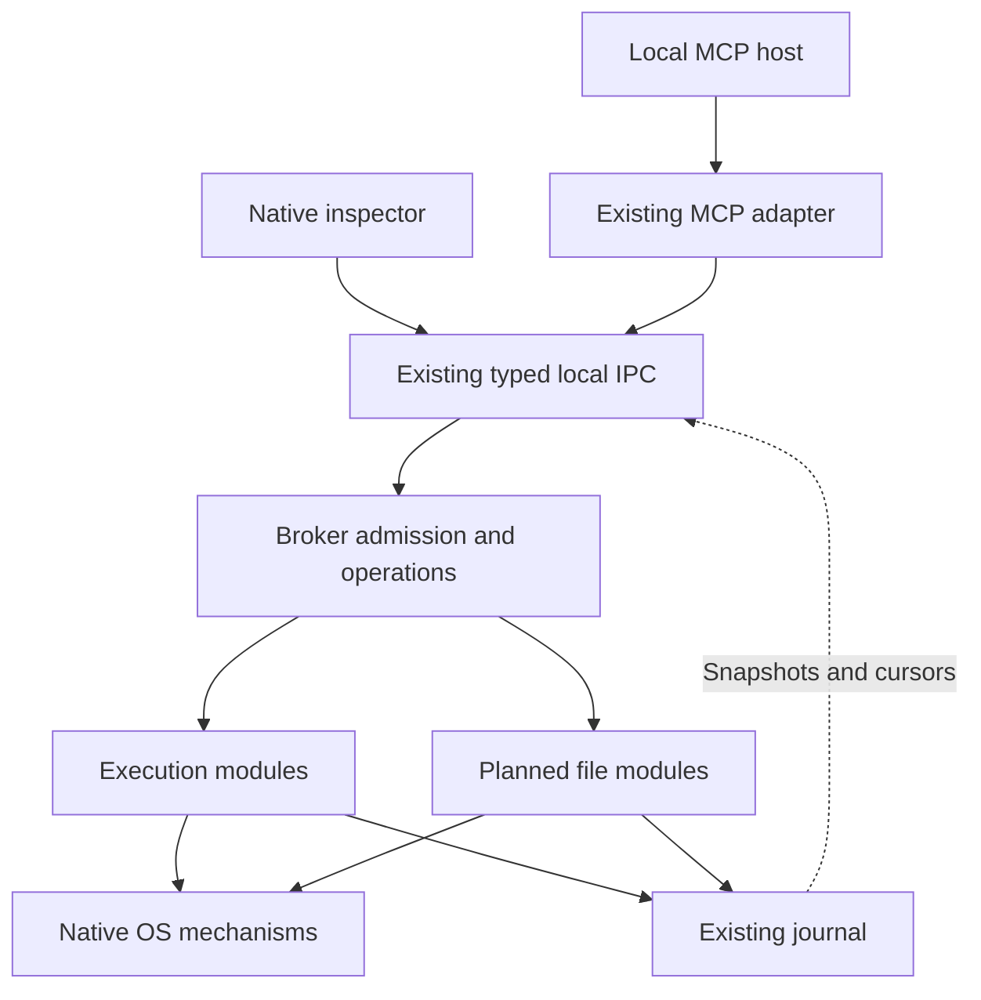

# Devagotchi architecture and growth plan

Planning revision: **2026-10-17 UTC**, including the user's website, public adoption, task-graph, and internal-mesh direction. This revision replaces the earlier feature sequence in this document. It is a source-grounded plan, not an implementation or performance report.

## 1. Outcome, authority, and evidence

Devagotchi will be a universal workspace bridge, beginning with a locally installed MCP host and a styled native desktop app and growing into an internal mesh of trusted brokers. Every admitted task is represented as a graph. The app must make work understandable and controllable: exact commands, workspace, authority, dependencies, attempts, live output, changes, cancellation, and recovery. Windows, macOS, and Linux are required product targets. Public documentation, API, and MCP surfaces make the product adoptable beyond one host.

The user's governing requirement is to plan for growth, extend existing responsibilities before creating new ones, and demonstrate material performance and experience improvements over Desktop Commander. The latest instruction also prioritizes building and publishing the website and its useful read-only reference API/MCP now. That work is authorized independently of native product release. This documentation revision does not claim task graphs, mesh execution, runtime HTTP, new native support, or performance improvements have been implemented.

**Confirmed destinations:** [eonsofstupid/devagotchi](https://github.com/eonsofstupid/devagotchi), the existing [Devagotchi Site](https://devagotchi.justsayit.chatgpt.site), and [devagotchi.net](https://devagotchi.net). The rebuilt Site is published as version 3, source commit `91bb93c49eb35fa37315973666ce71dbb437a659`; the [publication receipt](../verification/website-publication.json) records the deployed HTTP checks, enabled OAuth-protected MCP and installed plugin, source-download checksum, and verification limits. The custom domain is pending DNS validation. Visual browser QA and an authenticated named-client MCP tool call were not completed. The GitHub connector again returned 404; that does not establish whether the repository is private, missing, or otherwise inaccessible. Its instructions, source, CI, and reusable components remain uninspected. Repository integration and native installer publication have not occurred. The repository limitation does not block work on the existing Site.

### Evidence baseline

- The recovered source archive is the exact saved foundation, SHA-256 **075a259e66f50168c84989d8cedb81c1debadd08e950bf2f3abb468c4e2b7987**. All 77 paths recorded in its source manifest matched before this documentation revision.
- The reference audit uses DesktopCommanderMCP commit **f508e524469c26f6366e17dbfd3ee5a69d112127**. Its 49 included upstream blobs form a verified partial snapshot. The full upstream application was not installed or benchmarked.
- Historical Linux checks are preserved in [verification](../verification/README.md): core modules, real MCP/broker processes, protocol checks, IPC/execution boundaries, generated contracts, native builds, and seven actual WebKit/broker UI checks. They establish their stated scenarios, not scale readiness, a named host integration, or Windows/macOS support.
- **No comparative performance measurements exist.** This audit did not run new product tests, builds, or benchmarks. Static costs below are code observations; their user-visible magnitude remains to be measured.
- [Desktop Commander user evidence](desktop-commander-user-evidence.md) records primary reports, follow-ups, and positive fix evidence retrieved on October 17. It supplies workload and adoption hypotheses, not incidence statistics, reproduced defects, or proof of superiority. Website/reference-service checks are new evidence and must be recorded separately from the original Linux foundation results.

### Document ownership

This document owns product scope, architectural decisions, responsibility placement, phase order, and traceability. [Performance and experience specification](performance-and-experience-spec.md) owns workload definitions, metric meanings, proposed budgets, and OS acceptance scenarios. [Task-graph and mesh contract](task-graph-and-mesh-contract.md) owns the proposed task/step/attempt/output/event schemas and distributed failure semantics. [Implementation guide](implementation-guide.md) owns immediate publication and baseline packets and their entry/exit checks. The [user-evidence ledger](desktop-commander-user-evidence.md) preserves reported experience and resolution limits. The existing audit Page is a review surface and summary, not a second implementation contract. Historical evidence remains historical.

## 2. What scale means for this product

Scale first means a workstation that remains usable as work accumulates: several clients, many completed commands, noisy builds, large workspaces, interactive sessions, and a user who closes and reopens the app. It also means maintainers can add a tool or OS without reimplementing policy, lifecycle, storage, or UI data acquisition.

The proposed qualification envelope includes 100,000 historical operation records, 1/4/8/32 concurrent fixture jobs, 1/2/8 readers, 1 GiB mixed output workloads, 100,000-file workspaces with a separate million-file stress tier, and sustained mixed activity. These are workload sizes to test, not capacity claims or default settings. Overload must have a deliberate, bounded response.

Growth into a trusted internal mesh and public runtime API/MCP is committed direction, with the concrete mechanisms proposed in the graph/mesh contract. Begin with local graph execution, then two explicitly trusted brokers; local execution and file access must remain usable without a network coordinator. Autonomous fleet scheduling, a plugin marketplace, agent memory, WSL-specific integration, and screen/input automation remain separate future proposals. A relay is a possible routing mechanism to evaluate when a real deployment requires it, not an assumed authority or a prerequisite.

## 3. Verified constraints in the foundation

| ID | Observed code and consequence | Owner to extend | Required resolution |
|---|---|---|---|
| S01 | [execution.rs](../src/execution.rs), defaults and Broker::start: 64 retained operations and 4 concurrent jobs by default. Admission checks the entire retained map; finishing a job does not free a history slot. The configurable ceiling is 4096 records. | Execution admission and journal | Separate active admission, queue capacity, history retention, and retry evidence. Raising the constant alone is insufficient. |
| S02 | [journal.rs](../src/journal.rs), Journal::load, and Broker::open: every operation and its retained frames are loaded into memory at startup. | Journal queries and active operation registry | Load unfinished work and a bounded hot set; query history/output pages on demand. |
| S03 | Shared::output holds the common state mutex while Journal::append inserts one frame, deletes old frames, updates sequence, and commits. Frames are at most 1024 raw bytes; SQLite uses WAL and synchronous FULL. | Existing journal and output owner | Isolate blocking storage work and evaluate bounded batching, while preserving admission and durable-output ordering. |
| S04 | Broker::list sorts the full in-memory history under the same mutex on each call. Broker::read scans retained frames and builds encoded output while holding it. | Existing query paths | Indexed history pagination, shorter critical sections, bounded response work, and no history-sized read dependency. |
| S05 | run_job wakes on a 20 ms fallback timer. After root exit, group_has_executing_members reads /proc; cancellation settlement also scans it. | Execution's native Linux observation | Measure root-alive and root-exited cases separately. Improve native observation without dropping descendant-settlement checks or safe identity handling. |
| S06 | [useInspector.ts](../apps/desktop/src/useInspector.ts) polls lists at 3 s and active output at 1 s; backlog polling uses 100 ms delays. Selection resets its cursor. [App.tsx](../apps/desktop/src/App.tsx), Workspaces, fetches up to 32 operation details through four workers for the current page. | Existing inspector data owner and broker read contracts | One bounded cache/subscription owner, resumable updates, real workspace summaries, and no per-card discovery fan-out. |
| S07 | The root [Cargo manifest](../Cargo.toml) includes MCP dependencies; contracts import schema types through rmcp. The native host depends on the root crate. Execution and journal are both Linux-gated in [lib.rs](../src/lib.rs). | Existing crate, contracts, and feature configuration | Decouple schema authority from MCP and feature-gate consumer dependencies before adding packages. Unbraid shared code from native mechanics. |
| S08 | Execution's config_identity hashes grants plus retention/concurrency settings; request identity includes that hash. Tuning a limit can conflict with a previously valid retry. | Admission identity and persistence migration | Version request identity; distinguish request semantics, grant evidence, and operational tuning. Preserve legacy retry evidence. |
| S09 | Journal view_json stores the strict wire OperationView directly. Required field changes can make old records fail deserialization. | Existing journal and contracts | Version stored records and migrate explicitly; wire version, database schema version, operation revision, and output cursor have different meanings. |
| S10 | The app requires a broker socket argument/environment setting. One startup workspace and executable grant set, cleared environment, null stdin, and a five-minute maximum deadline define the current execution scope. | Broker configuration, native host, and execution | Native setup, workspace grants, controlled environment profiles, long-lived job semantics, and explicit terminal mode must be designed together. |

These findings justify targeted changes. They do not prove which cost dominates wall time or that a particular proposed remedy is faster.

## 4. Architecture rule: retain owners, reduce coupling

Retain **one per-user broker with its authoritative local journal**, **one canonical contract source**, the **official-SDK MCP adapter**, and the **native inspector**. A mesh connects those existing installation owners; it does not create a broker per task/workspace or one globally writable journal. A module split is a code-organization change; it does not imply another process, service, database, or public API.

The broker owns work independently of observers. The MCP adapter maps protocol calls. The Tauri host handles local application integration. The UI presents broker evidence. None of these observers gets a second implementation of admission, permissions, cancellation, or recovery.

### Responsibility and reuse map

All new paths below are **proposed destinations**, not existing implementations.

| Responsibility | Existing authority | Placement as it grows | Boundary decision |
|---|---|---|---|
| Requests, results, errors, revisions | src/contracts.rs and generated schema/TypeScript | Keep this authority; split into local contracts modules only when feature size warrants it. Depend directly on the compatible schema library, not the MCP adapter's re-export. | No second hand-authored DTO model or generated-file edits. |
| Admission, job lifecycle, concurrency | Broker and Shared in src/execution.rs | Move the existing broker policy/lifecycle into src/broker.rs within the same crate when native seams are extracted; src/execution retains process orchestration and execution/platform contains native mechanics. This relocates the current owner rather than creating a second one. | One operation state machine across OSes and future durable file work. |
| Task graphs and attempts | Existing admission/lifecycle and journal; no graph engine currently exists | Extend the same broker with bounded dependency readiness, task aggregation, and attempt-to-operation bindings; persist versioned graph records in the existing journal. | A one-command task is a one-node graph; a retry never acquires a second execution owner. |
| Persistence, recovery, history, retention | src/journal.rs | Versioned records, migrations, indexed queries, one bounded writer, and commit notifications inside this owner. | No separate audit DB, event service, or storage daemon. |
| Framing and typed client | src/ipc.rs | Add reusable typed get/read/cancel/list mappings, compatibility negotiation, and bounded observation to this module. Native endpoint files remain private implementations. | Native host and MCP reuse the same client semantics. |
| Runtime HTTP/MCP and trusted mesh | Existing typed client, broker configuration/grants, admission, and journal | Thin authenticated transport bindings; explicit peer identities, target-scoped delegation, durable delivery/reconciliation, and later routing inside those owners. | Public exposure and routes confer no additional workspace authority; no automatic rerouting of ambiguous effects. |
| Private installation state | Existing IPC StateGuard and journal private-file checks | Inventory shared checks before extraction. If duplicate OS identity/private-path mechanics need reuse, colocate a small internal helper with the current state owner. | Do not create a general filesystem framework to solve two internal checks. |
| Workspaces and grants | Current BrokerConfig and admission validation | Extract a broker-owned workspace module when persisted workspace/grant APIs arrive. Store authoritative records in the existing journal. | No frontend-only permission state; no broker per workspace. |
| File reads/search/changes | Planned broker capability | Add src/files modules for this real new responsibility; reuse grants, operation identity for long work, journal, budgets, and native identity helpers. | A file capability is justified; another lifecycle engine is not. |
| Desktop data | BridgeClient, useInspector, generated types | One inspector cache/subscription owner. Workspaces consumes explicit broker workspace data and shared cached operation summaries. | Components cannot independently reconstruct authoritative workspaces from history. |
| Desktop presentation | App.tsx, styles.css, existing mark/components | Extract feature views and reusable components from the current app. Reuse its tokens and primitives first. | No new design-system package solely to rearrange this app. Inspect any proposed external system before adoption. |
| Startup and distribution | Existing broker binary and Tauri host | Package and locate the same broker; implement per-user launch/lifecycle behavior using native facilities. | Privileged services and an additional supervisor process require a demonstrated need. |
| Public website and reference API/MCP | Existing managed Devagotchi Site | Reuse its Vinext, React Aria Components, Style Dictionary, source, and publication workflow. Serve real read-only documentation, local schemas, and labelled examples. | This surface is publishable now and has no workstation execution authority. |

Use Cargo features and direct module reuse first to stop desktop consumers inheriting unnecessary protocol/execution dependencies. Introduce a separate crate only if a concrete dependency cycle, independently shipped artifact, or build boundary remains after that change. Document the evidence and preserve a single type authority.

### Test for every proposed new boundary

Before adding a service, crate, registry, cache, or subsystem, record: the responsibility it owns; the existing owner inspected; why extension is inadequate; what existing code it replaces; authoritative state; dependencies and failure behavior; and the acceptance check. If the proposal merely routes the same work through another layer, extend the current owner instead. A native implementation may differ in mechanism while preserving the shared contract.

## 5. Shared contracts to settle before expansion

### 5.1 Admission, concurrency, and retry identity

Use a stable operation ID independent of OS PID, transport request ID, and UI selection. A caller wait may end while an admitted operation continues. Admission must persist before launch; a lost response must be reconcilable.

Separate four limits: running jobs, bounded queued work, retained historical metadata, and retry evidence. Queue admission is explicit and recorded; an accepted queued operation has its own identity and can be cancelled before launch. Fairness should prevent one client/workspace's output or long searches from starving control requests or short reads. Start with a small deterministic scheduling policy; do not add a distributed scheduler.

Queue waiting and execution deadlines have separate declared start points and budgets. Pin environment/profile versions at admission; revalidate current workspace/grant authority before dispatch and again at a mutation boundary. A revoked, cancelled, or expired queued operation must reach the declared outcome without an unintended launch. Test enqueue followed by revoke/remove/expire/cancel before dispatch.

The request digest covers semantic inputs: execution context, exact program/arguments, cwd, selected environment profile, terminal mode, and execution policy. Retention tuning and unrelated concurrency settings must not redefine the same request. Authorization is checked against current authority; the admitted record keeps its grant evidence. Changing grants does not rewrite historical evidence.

Retry scope must distinguish the authenticated local scope and workspace. Client-provided names are attribution, not authentication. Retain legacy key bindings during migration. History deletion must never silently turn an old retry into fresh execution. The proposed bounded solution uses versioned retry contexts with an explicit validity window and expiry behavior; expired contexts reject before effects. Do not simply delete random-key tombstones and retain an indefinite retry promise.

The broker validates retry contexts; caller-supplied expiry timestamps are insufficient. Define restart and clock-change rules, and fence incompatible old clients/writers before reclaiming evidence. An old client or broker using migrated state must fail explicitly when unsupported rather than treat discarded history as an unseen request. Qualify upgrade and downgrade paths before enabling reclamation.

### 5.2 Persistence and live output

Keep one SQLite writer with a bounded mailbox. Isolate blocking calls from async execution; measure batch size and commit cadence. This is an internal worker, not a new service. Tokio documents separating blocking and async work, and SQLite WAL still permits only one writer at a time. [Tokio](https://tokio.rs/tokio/topics/bridging), [SQLite WAL](https://www.sqlite.org/wal.html).

Admission/state persistence has priority without starving output. A journal refactor must preserve:

1. A client disconnect cannot abandon committed admission before broker ownership is established.
2. A reader cannot receive a sequence labelled durable before its transaction commits.
3. Terminal state orders after preceding retained output is committed, or explicitly records missing/incomplete output.
4. Writer failure closes new admission, preserves uncertainty, and cannot become an in-memory success.
5. Slow or disconnected observers cannot block child-pipe drainage.

Keep logical metadata and output policies separate inside the journal. Query historical pages through indexes rather than loading all frames into the live registry. Account for database, WAL, temporary files, cached bytes, diagnostics, and any future spool when defining physical budgets. Checkpoint and reclamation must be measured; deleting rows is not proof that disk usage shrank.

A bounded system cannot promise unlimited durable capture from an arbitrarily fast producer during storage failure. Define two explicit outcomes: bounded tail capture with recorded dropped ranges, or a selected full-capture policy that stops the operation when durable storage cannot keep up. Default policy selection is an implementation decision before output optimization, not a silent loss of the current contract. Raw bytes remain recoverable for retained ranges.

Current gaps describe prefix eviction. Dropping buffered data can create interior holes, so that policy requires durable range evidence, cursor progression through holes, and declared decoding across missing bytes. Force a missing middle range, resume capture, restart, and read with independent cursors. If the writer cannot durably record the gap, output completeness remains uncertain.

### 5.3 Observation, queries, and compatibility

Extend existing IPC with a bounded subscription or wait-for-change path; do not add a WebSocket service. The first implementation should send compact change notifications and let existing cursor reads fetch bounded ranges. Measure whether persistent connections are needed after eliminating polling/fan-out; a new connection pool is not automatically an improvement.

Define an atomic snapshot plus committed change watermark. Resume against that watermark; if retention has passed it, return an explicit resync requirement. A slow subscriber gets bounded buffering and a gap/resnapshot response. It never stalls the journal. Preserve per-operation output sequences separately from a broker-wide change revision.

Add monotonic operation revisions for state ordering; wall-clock updated_at alone is insufficient for ordering concurrent responses. Broker generation identifies a restart; it does not imply resumed process ownership. Persist authoritative operation records, with compact change records in the same journal when required for resumability. Do not introduce full event sourcing merely to refresh a UI.

Distinguish outcome certainty, resource settlement, and output completeness. The current State::fault can mark still-active work Unknown while cancellation and cleanup continue; Shared::finish clears active ownership later. A generalized terminal enum or event must not tell clients that resources stopped merely because the outcome is unknown.

Version the local API explicitly and negotiate capabilities. Strict v1 decoders cannot silently accept added fields. Pre-release changes may use a clean new version and an explicit mismatch result rather than speculative legacy shims. Saved operation/retry evidence must still migrate deliberately or remain clearly historical; incompatible old writers fail before effects. Persisted record versions and wire versions are independent. Generated Rust/schema/TypeScript consistency remains a required gate.

MCP continues to use the official SDK's supported protocol behavior. Native inspector subscriptions are local broker contracts; they do not imply arbitrary notifications to every MCP host. Validate the named host and negotiated protocol before exposing optional MCP facilities. [MCP architecture](https://modelcontextprotocol.io/docs/learn/architecture).

### 5.4 Workspaces, files, and environment

Workspace selection creates a broker-owned identity and grant. A path is an input to resolving a resource, not a universal identifier. Never lowercase every path or treat a canonicalization snapshot as protection against later path replacement. Current public paths require UTF-8; before broad file coverage, define a native-path representation and broker-issued resource references so display text does not become a lossy filesystem identity.

The current trust scope is the OS user. Before exposing grant administration, decide how the broker distinguishes the operator-controlled path from client requests, or explicitly retain a trusted-user model with that limit. Hiding an administrative method from the MCP catalog, a claimed client name, or an approved boolean is not broker authentication. Do not promise isolation between mutually untrusted same-user programs without a verified mechanism.

Bounded metadata/read/list calls can be direct broker queries. Long searches and mutations use the existing cancellable operation owner where useful. Do not allocate a durable background job for every cheap read, or build a second job system for search. Evolve process-specific details into typed operation variants; a file result must not invent executable, exit-code, or stdout fields merely to fit the current process view.

File changes require a deterministic proposal, current target identity and revision, broker serialization, supported native replacement, metadata policy, and recorded verification. A check followed by rename is not atomic compare-and-swap against arbitrary external editors. Initial support is single-file replacement on qualified local filesystems. For stronger isolation, propose a controlled working-copy/integration workflow; do not promise universal rollback of external side effects.

Environment profiles must make ordinary developer tools usable without silently inheriting every secret or interactive shell mutation. Resolve executables deliberately, store profile identity, show meaningful launch errors, and define explicit shell invocation. Windows executable argument encoding must be tested using child-observed arguments; custom command-line parsers and batch interpreters require declared behavior. [CreateProcessW](https://learn.microsoft.com/en-us/windows/win32/api/processthreadsapi/nf-processthreadsapi-createprocessw).

### 5.5 Native app experience

The real product flow is install/open, select a workspace, inspect the grant, connect a named local MCP host, run work, watch it, cancel or review changes, and return later. Routine operations inside an established grant should not require repeated setup or unnecessary prompts.

Keep activity, selected detail, output, and cancellation tied to the same operation ID. Cache bounded recent views, batch render updates, virtualize sufficiently large output/history, and suspend unneeded work when a view is hidden. Preserve selection, follow/scroll intent, keyboard focus, and partial-history indicators. Measure these behaviors in the actual native webviews.

Close window, quit inspector, stop broker, log out, sleep, and reboot are different actions. The UI must show the resulting behavior accurately. A disconnected view may show the last recorded state with its freshness; it cannot certify that a job is still running. Terminal mode needs a real terminal renderer and explicit input writer ownership; ordinary output stays safe plain text.

### 5.6 Every task is a graph; execution ownership stays explicit

The user intent is locked; the [candidate contract](task-graph-and-mesh-contract.md) is proposed and unimplemented. An admitted task contains a bounded execution DAG. A logical step can have several recorded attempts; each attempt binds to an actual broker operation. Provenance links tasks, attempts, outputs, and committed changes. Mesh topology is a separate graph that may contain cycles and conveys neither dependency order nor authority. Cheap observational reads do not recursively create durable tasks.

Freeze an admitted graph revision and typed output bindings. Transport redelivery retains the same attempt identity; deliberate eligible retries create new attempts. Unknown effects never automatically repeat. Task cancellation stops new scheduling and requests cancellation of admitted work, while showing delivery, acknowledgement, and resource settlement separately. The graph owner aggregates evidence; native execution remains responsible for the operation's observed outcome.

Start with one fixed owner broker per task. Each target broker rechecks its own grants and records admission in its own journal. Durable outbox/inbox bindings, bounded admission contexts, authenticated peer identities, and owner epochs are proposed mechanisms for handoff and stale-dispatch rejection. They do not guarantee exactly-once external effects, instantaneous cancellation during a partition, or automatic owner failover. Reconcile uncertain attempts before rescheduling. Local-only tasks continue without mesh availability.

### 5.7 Public adoption now; runtime exposure after its own gates

The existing Site's publication packet is authorized now. Its public reference HTTP API and MCP provide capability/status information, current local tool schemas/documentation, and an explicitly illustrative graph example. They do not start workstation commands, read local files, alter grants, or turn documentation schemas into callable runtime tools. Website claims and examples identify implemented, proposed, and unsupported behavior.

Use an explicit modern 2026-07-28 profile for the initial reference MCP; verify required per-request metadata, header/body agreement, bounded responses, Origin handling, structured results, and unsupported-method/version errors. No legacy initialization shim or Tasks extension is assumed. Keep actual publication/protocol receipts separate from historical stdio and Linux tests. The future runtime API and authenticated HTTP MCP map the same broker contract, with subject/audience/scope checks and target grants; they are not implemented by publishing the reference service. See the [graph/mesh contract](task-graph-and-mesh-contract.md) for the precise boundaries and primary protocol sources.

## 6. Native mechanisms: one product, separately earned support

| Area | Windows | macOS | Linux | Shared owner |
|---|---|---|---|---|
| Ordinary execution | Explicit executable and argument encoding; owned process/job handles; assignment failures leave no uncontrolled runnable child | Darwin spawn/group/exit mechanics; no Linux /proc assumptions | Preserve current identity discipline; evaluate pidfd observation and membership checks | Execution lifecycle and admission |
| Cancellation | Verify associated Job Object membership; handle nesting/breakaway and broker-handle lifetime | Group signalling with honest limits for descendants that leave it | Group signalling; delegated cgroups only if a stronger scope is actually supported | Shared cancellation policy; native proof |
| Terminal | ConPTY channel servicing, resize and teardown | PTY, controlling session, resize/input | PTY, controlling session, resize/input | Shared terminal mode and input ownership |
| Local IPC | Named pipe with explicit DACL, local policy and peer identity | Unix endpoint and native peer credential validation | Private Unix endpoint, peer credentials, suitable runtime directory | Existing framing/client/admission |
| File operations | Object identity, reparse points, sharing violations, replacement metadata | APFS case/Unicode behavior, permissions, coordinated documents where relevant | Descriptor/path identity, links, file/directory sync | File contract and journal |
| App lifecycle | Per-user startup, session/shutdown/sleep behavior | Finder/MCP launch attribution, TCC, app close/sleep behavior | Desktop/session startup, logind behavior, distro/runtime dependencies | Existing host and broker lifecycle |

Microsoft documents Job Object membership and exceptions, so cancellation claims must name that scope. ConPTY has its own channel and teardown requirements. Named-pipe defaults must not be treated as owner-only protection. [Job Objects](https://learn.microsoft.com/en-us/windows/win32/procthread/job-objects), [ConPTY](https://learn.microsoft.com/en-us/windows/console/creating-a-pseudoconsole-session), [pipe security](https://learn.microsoft.com/en-us/windows/win32/ipc/named-pipe-security-and-access-rights).

macOS mandatory access controls apply independently of App Sandbox. Validate actual Finder-launched and MCP-launched flows; do not prescribe Full Disk Access or sandbox entitlements as a universal fix. Darwin peer credential APIs can support the existing Unix endpoint. [Apple permissions](https://developer.apple.com/forums/thread/678819), [getpeereid](https://developer.apple.com/library/archive/documentation/System/Conceptual/ManPages_iPhoneOS/man3/getpeereid.3.html).

Linux pidfds can support event-oriented root observation; they do not solve descendant containment. Cgroup-based guarantees depend on usable delegation and controlled membership. A process that changes session can leave a process group on Unix. [pidfd_open](https://man7.org/linux/man-pages/man2/pidfd_open.2.html), [cgroup v2](https://docs.kernel.org/admin-guide/cgroup-v2.html), [Darwin setsid](https://developer.apple.com/library/archive/documentation/System/Conceptual/ManPages_iPhoneOS/man2/setsid.2.html).

Choose a minimum OS/architecture/filesystem/distribution matrix from real test access in G0. Proposed initial distribution is a normal per-user desktop install with the existing broker; macOS direct signed/notarized distribution is a candidate, not a selected App Store requirement. Windows-native work and WSL are distinct execution contexts; WSL-specific guarantees remain deferred. Do not advertise “Linux support” without naming tested distributions and desktop/runtime conditions.

## 7. Improvement commitments and release evidence

Correctness and speed are separate gates. Preserve the audited output/identity fixes while measuring work users feel:

| Improvement | Existing reference evidence | Devagotchi acceptance |
|---|---|---|
| Output fidelity and concurrent observation | F01/F02 source harnesses | Byte-faithful retained output, independent readers, responsive live view under load |
| Bounded resources during noisy work | F06 source findings; no exhaustion benchmark | Explicit memory/storage/queue budgets and fair control latency under a flood |
| Persistent command identity and recovery | F05/F07 scope findings | Same operation after observer reconnect; unknown effects never silently replay |
| Workspace and file correctness | F03/F04/F09 | Native path/object tests, real grant flow, stale/conflicting changes handled honestly |
| Real interactive behavior | F05 ordinary-pipe execution path | PTY/ConPTY fixtures, resize, Ctrl-C, input ownership, detach/reattach |
| Work visible in a real app | User requirement; existing inspector | Fast actual-data navigation, truthful status, keyboard access, meaningful setup/errors |
| Long-term maintainability | Latest user requirement; S07/S09 | New capability/OS extends existing owners, generated contracts, compatible migrations |
| Adoption and clear failure ownership | [Primary user reports](desktop-commander-user-evidence.md), including resolved and host-specific cases | Installation separate from readiness; actual host/schema/environment tests; correct target receipts; truthful health; quiet tool results |
| Composable work and internal mesh | Latest user direction; proposed graph/mesh contract | One-node and branching tasks reuse operations; bounded observation; authenticated two-broker handoff; no replay/rerouting of unknown effects |

The user-evidence ledger is a purposive sample, not a bug census. Preserve maintainer fixes and reporter corrections when choosing work: a closed or open issue alone does not establish current artifact behavior. Candidate claims must be supported by matched current-artifact tests, not by repeating an old complaint.

The performance specification defines three comparisons: the frozen Devagotchi foundation, a candidate Devagotchi build, and a reproducible pinned Desktop Commander build. Compare equivalent semantics and report full broker/adapter/UI process-family costs separately from backend-only costs. Feature absence is a parity gap, not a zero-time benchmark.

A “faster” claim names the workflow, OS, hardware, versions, durability/retention configuration, distribution, and failures. A default provisional improvement gate is a 20% reduction in a predeclared user-facing latency or resource metric, supported by repeatability and uncertainty analysis, with no material correctness or other-budget regression. Targets can be revised before candidate results are examined, with a recorded reason. No current result satisfies that claim.

Include every attempted request in the outcome denominator. Unexpected rejections/timeouts fail supported-load acceptance; success-only latency cannot justify shedding slower requests. Each narrow optimization declares its applicable absolute budgets and protected metrics in advance. Unrelated baseline misses remain visible phase/release requirements and cannot be hidden by a local improvement.

## 8. Dependency-ordered execution phases

Phase IDs G0–G5 replace the earlier generic Phase 0–5 sequence. Product requirements are committed; specific mechanisms and numeric budgets remain proposed until their evidence gate. No phase is complete merely because a document or mock UI exists.

**P0 — Public reference publication is an immediate parallel packet.** Rebuild and publish the existing Site, its read-only HTTP/MCP reference surface, source/document links, and truthful capability status. Verify actual published routes and record the receipt. It does not wait for G0 benchmarks, every native OS, or G5 installers. Pending custom-domain DNS does not prevent publication on the existing Site URL. G5 governs production distribution and advertised runtime capabilities, not permission to publish useful reference material.

| Phase | Entry and outcome | Principal work and paths | Exit evidence |
|---|---|---|---|
| **G0 — Reconcile and measure** | Verified recovered baseline; inspect repository when accessible | Inventory actual repository instructions/components; freeze upstream/candidate inputs; add bounded benchmark instrumentation/harnesses through the next guide; decide OS/test-host matrix and semantics before optimization | Reproducible baseline report, owner map reconciled to real repo or explicitly isolated, approved metric definitions, no invented upstream/native results |
| **G1 — Extend the foundation for sustained use** | G0 baseline and contract decisions | Versioned journal/identity migrations; bounded writer and history queries; typed IPC reuse; inspector cache/change observation; extract native execution seams; feature-gate dependencies; scoped local graph records/dispatch after their prerequisites | Historical correctness regressions pass; S01–S09 addressed or bounded by measured evidence; performance/retention/reconnect and migration gates; graph packets earn their own evidence |
| **G2 — Native ordinary work on all three OSes** | Shared semantics and narrow ports established | Windows/macOS providers; certify Linux changes; native setup and workspace/grant identity; environment/deadline/lifecycle rules; named local MCP host workflow; qualify local graph attempts on each target | Same ordinary-command and selected graph workflow runs through real app and host on each target, including disconnect, cancellation, failures, sleep/restart behavior |
| **G3 — Workspace file workflow** | Grants, identity, migration and native file seams available | Bounded list/read/search, ignore/cancellation semantics, proposal/revision/commit/recovery, actual workspace UI; all reuse broker/journal | Native local-filesystem matrix; large-workspace performance; stale revision/race/interruption/metadata checks; usable review and conflict flow |
| **G4 — Interactive workstation experience** | Ordinary execution and input authority settled | PTY/ConPTY, bounded terminal I/O, writer lease, resize, renderer, retention-aware history and keyboard/focus polish | Real terminal and native UI workloads on each OS, no observer-driven job loss, measured responsiveness under output load |
| **G5 — Release and support** | Required capability and experience gates passed | Install/update/uninstall, migration/rollback, signing/provenance, clean-machine client setup, support matrix, and updating already-publishable website content to match release evidence | Signed distributable evidence where applicable; native install/update recovery; end-to-end host flows; qualification for each advertised graph/mesh/runtime API capability and performance claim |

### Scoped graph and adoption packets within the phase plan

| Packet | Dependencies that matter | Existing owners and exit evidence |
|---|---|---|
| **G1.GA — Graph records** | Versioned identity/storage contract and canonical schema pipeline | Contracts/journal: one-node mapping, bounded DAG validation, migration/retry evidence, atomic admission, paged queries. |
| **G1.GB — Local graph execution and view** | G1.GA plus stable admission/cancellation and snapshot/revision contracts | Existing broker/execution and inspector: attempts use real operations; dependencies, explicit retries, cancellation races, output bindings, and bounded expansion pass. No file/PTY implementation is required for ordinary-process DAGs. |
| **G2.GC — Native graph qualification** | G1.GB and each participating platform's execution/authority behavior | Same task semantics through real native attempts; Windows/macOS/Linux support remains separately earned. |
| **A1 — Authenticated runtime API/MCP** | Versioned broker contract, authenticated subject/grant path, and qualified participating runtime | Thin transport bindings: audience/scope, schema, overload, abandoned waits, and named-client behavior pass. It may be piloted on qualified platforms without claiming others. |
| **M1 — Two trusted brokers** | Stable local graph lifecycle, peer identity/delegation, and durable handoff contracts | Existing configuration/grants, journal, and routing: target receipts, partition/ack-loss, stale epochs, pending cancellation, authorized transfer, and reconnect tests pass. No implicit fallback or owner failover. |

These packets extend G1/G2 owners; they are not another execution hierarchy. Broader mesh routing follows demonstrated two-broker behavior. File and terminal steps enter graphs only after G3/G4 qualify those capabilities. Exact future mechanisms remain proposed and do not block P0 or local work.

Cross-platform design is active from G0 and native ports are exposed in G1. G2 must precede a broad file/terminal expansion that would otherwise cement Linux-only assumptions. Native engineers can prepare bounded platform experiments alongside G1 after shared contracts are fixed; they cannot fork lifecycle or journal logic.

Within G1, sequence identity/storage contracts before writer/history changes, and snapshot/revision contracts before UI subscriptions. After contract ownership is stable, journal, IPC/UI, and native-mechanism work can run in parallel on disjoint paths. Each integration packet names a single contract owner and merges through the same regression gates.

Do not attach dates until repository access, native test capacity, and staffing are known. Size the work by acceptance packets, not a promise that another short coding pass completes the product.

## 9. Decision and parking register

Status describes the decision, not delivery: **LOCKED** is user direction; **COMMITTED** is retained scope/current ownership; **PROPOSED** needs evidence before adoption; **DECISION_REQUIRED** blocks its named gate; **DEFERRED** is outside current execution; **REJECTED** is an explicitly disallowed approach.

| ID | Status | Decision, owner, destination, and reconsideration trigger |
|---|---|---|
| D01 | LOCKED | Devagotchi universal workspace bridge, local MCP host and native app, Windows/macOS/Linux, own repo/domain, public API/MCP adoption, and growth into an internal mesh. User owns product direction. |
| D02 | LOCKED | Extend existing responsibilities first; require measured performance and experience improvements. Applies to every phase and implementation review. |
| D03 | COMMITTED | Retain the existing broker and authoritative local journal per installation, one type authority, MCP adapter, and inspector. Mesh connects these owners. Change boundaries only with demonstrated responsibility/dependency need. |
| D04 | COMMITTED | Preserve historical source audit and correctness evidence with their limits. Verification owner records new runs separately. |
| D05 | PROPOSED | Bounded journal worker/batching, indexed history, resumable observation, narrow native modules, feature-gated dependencies. G1 owners must meet failure ordering and benchmark gates. |
| D06 | PROPOSED | Numeric performance/experience budgets in the companion specification. G0 benchmark owner freezes or revises them before comparing a candidate. |
| D07 | DECISION_REQUIRED | Named locally installed MCP host. Product/integration owner selects before G2 host certification; scripted baseline work can proceed meanwhile. |
| D08 | DECISION_REQUIRED | Minimum OS/architecture/filesystem/distribution matrix and native test access. Release owner settles before G2 certification; no implied coverage from Linux. |
| D09 | DECISION_REQUIRED | Versioned retry retention, durable output overflow policy, deadlines across sleep, and queued-work behavior. Core owner resolves with evidence before the affected G1/G2 contract changes. |
| D10 | COMMITTED | File/read/search/edit and real interactive execution are required to become a useful Desktop Commander replacement. Implementation is pending G3/G4. |
| D11 | COMMITTED | Runtime API/MCP adoption and a trusted internal mesh are now explicit user direction. Contracts, authenticated handoff, and routing mechanisms are PROPOSED in task-graph-and-mesh-contract.md; A1/M1 earn implementation evidence. A relay is optional, not a new authority or local prerequisite. |
| D12 | DEFERRED | Integration with other ecosystem repositories, including RRFlow. Inspect actual code, licenses, contracts, and ownership first; no dependency is assumed. Reuse the already-selected Site stack and existing product components. |
| D13 | REJECTED | New broker/service/database per tool, transport, or OS; blanket path lowercasing; a workspace selector described as an OS sandbox. Reconsider only a genuinely new requirement with proof. |
| D14 | REJECTED | Speed claims from Rust/Tauri choice, exactly-once arbitrary side effects, automatic replay of unknown work, or three-platform claims from Linux-only checks. |
| D15 | LOCKED | Every admitted task is a graph, including a one-node command. Existing broker/journal own it; schema details, bounds, and scheduling mechanisms remain PROPOSED. Observational reads do not recursively create tasks. |
| D16 | LOCKED | Build and publish the existing Site and useful read-only reference API/MCP now. P0 runs independently of G5 runtime/installer release; publication success requires its own receipt. |
| D17 | PROPOSED | Bounded immutable DAGs, attempt-operation links, local graph aggregation, fixed task owner, durable delivery, target admission contexts, and epoch fencing. Adopt through G1.GA/G1.GB/A1/M1 evidence. |
| D18 | DEFERRED | Autonomous fleet scheduling, plugin marketplace, agent memory/indexing, WSL-specific integration, and screen/input automation. The mesh instruction does not automatically select these capabilities. |
| D19 | PROPOSED | `shippinAI/agent-hub` is frozen for reference; its design (`docs/devagotchi/`, imported 2026-10-24) lives here and its capabilities are ported per the [absorption ledger](devagotchi/README.md). Two conflicts need a ruling: GUI control (Go D7 v0.1 vs D18 deferred) and the bridge tool set (28 Go tools as the parity target for the Rust broker). |
| D20 | LOCKED | **One `devagotchi` binary.** Vibers download and run one thing: a multicall binary carrying the broker, the stdio adapter, the link, the hub and the board (`devagotchi start`, `devagotchi mcp`, `devagotchi login`, `devagotchi board …`, `devagotchi link`, `devagotchi hub`). The process boundaries stay (D03: the broker owns jobs, the adapter stays thin, `core`/`mcp` code paths make no network call); only the packaging changes. Ruled 2026-10-24; ADR through the component. §13. |
| D21 | LOCKED | **Three tiers, hosted by default.** (1) Vibers run locally; (2) the default hub is hosted — friends-and-family private cloud at devagotchi.com first, extending into shippin.cloud as it evolves into the bridge for all a user's systems; a free account is required and enforced there, realistically one project per free account; (3) the advanced tier self-hosts from a Docker image or on their own VM/server (`install-devagotchi.sh --role hub`). Dev tokens are for tests only. Ruled 2026-10-24. §13. |
| D22 | LOCKED | **Sign-in rule "both".** The default build signs in on first run with a free Shippin account (device-link, RFC 8628, like `shippin_connect`) and keeps working through an offline grace; local-only and self-hosted runs may be accountless (`--local`). Ruled 2026-10-24; the grace period and what `--local` loses are PROPOSED — 14a carries the proposal in code (seven days past expiry, reported by `whoami`; `--local` loses what packet 15 adds: sync to the hosted hub). §13. |
| D23 | LOCKED | **Board of record is the user's choice; both must work.** The project's board stays a local file (B02) and syncs to the account's hosted hub when signed in — the hosted path is the one made smooth, because most users will take it. How a machine reaches the hub is pluggable: Shippin's own link first, then Tailscale, Cloudflare Tunnel and custom bridges, chosen without being told ("smart"). Direction ruled 2026-10-24; the sync protocol and bridge selection are PROPOSED. §13. |

Repository access is an observed external blocker, not a product decision. It blocks reconciliation with and publication to that GitHub repository; it does not block the existing Site, reference publication, or useful isolated work. Website publication is already authorized. Nonblocking future implementation details remain proposed rather than becoming artificial permission gates.

## 10. Requirement traceability

| Requirement | Source | Owner / destination | Phase / verification | Status |
|---|---|---|---|---|
| Extend before adding boundaries | Latest user direction | Architecture; section 4 | G0 owner inventory; every packet identifies reused owner and removed duplication | LOCKED |
| Real performance gains | Latest user direction | Core/UI; performance specification | G0 matched baseline; G1/G5 measured comparison | LOCKED |
| Styled real desktop experience | User direction | Existing app and typed client | G2/G4 native workflows, accessibility and responsiveness | LOCKED |
| Windows/macOS/Linux | User direction | Execution/IPC/file native mechanisms | G2–G5 native matrix and clean-machine evidence | LOCKED |
| Local MCP integration | User direction | Existing adapter and app setup | G2 named host workflow | LOCKED |
| Every admitted task represented as a graph | Latest user direction | Existing broker/contracts/journal and inspector | G1.GA/G1.GB, G2.GC; graph contract | LOCKED |
| Public website/reference API/MCP now | Latest user direction | Existing Devagotchi Site | P0 published-route and protocol receipt; independent of G5 | LOCKED |
| Runtime API/MCP and trusted internal mesh | Latest user direction | Existing typed client, broker/grants, journal, and adapters | A1/M1 auth, target identity, partition, retry, and cancellation gates | COMMITTED |
| Stable identity, Unicode, independent readers | F01/F02/F05/F07 | Execution/contracts/journal | G1 historical regressions plus saturated/reconnect cases | COMMITTED |
| Bounded sustained history/output | F06, S01–S04 | Journal/admission/output | G1 quotas, long runs, cold reopen and overload | COMMITTED |
| Migration and retry compatibility | S08/S09 | Journal/contracts/admission | G1 legacy fixtures and tuning/retry cases | COMMITTED |
| Workspace authority and file correctness | F03/F04/F09 | Workspace/files; existing journal | G2/G3 grant/revision/path/failure matrix | COMMITTED |
| Correlated evidence and recovery | F08, user experience | Journal and inspector | G1–G4 denial/failure/admission/result/unknown evidence | COMMITTED |
| Interactive programs | F05 and product parity | Execution mode and existing UI | G4 PTY/ConPTY native scenarios | COMMITTED |
| Truthful runtime distribution | User destinations | Release/app packaging | G5 install/update/support evidence; P0 reference availability is separate | COMMITTED |
| Visible failure ownership and adoption trust | Primary user-evidence ledger | Setup, diagnostics, native adapters, and actual public/runtime contracts | Preserve fix evidence; test host environment, content fidelity, health, handle cleanup, and quiet output | COMMITTED |
| Hosted runtime/relay ownership, where used | F10 and new mesh direction | Existing broker authority plus any justified routing deployment | Inspect actual service source and test its auth/delivery boundaries before runtime exposure; docs Site has no such authority | PROPOSED |

## 11. Next gate and handoff

The immediate public packet is **P0: rebuild and publish the existing Site and read-only reference API/MCP**. The core's next packet remains **G0: source reconciliation and a reproducible baseline**. They can proceed independently, as detailed in [implementation-guide.md](implementation-guide.md). G0 makes optimization choices concrete; the scoped graph and mesh packets extend the same owners after their actual dependencies are ready.

The current foundation remains a Linux proof. Task graphs, trusted mesh execution, and runtime HTTP are unimplemented. Retain its useful ownership and correctness work while addressing the documented scale and experience limits. Public reference publication is a separate deliverable with a separate receipt; it establishes no new native or performance result.

## 12. Absorbed design: shippinAI/agent-hub

The product design written against the Go hub in October 2026 — data model, bridge, access flow,
subscriptions, providers, guides, costs, the approvals PWA, the Gold build plan — is imported
verbatim under [`docs/devagotchi/`](devagotchi/README.md) with a ledger that maps every Go
capability to its owner here, its status, and the increment that ports it. Where those documents
and this plan disagree, this plan wins; where this plan is silent, they govern. D19 records the
freeze and the two conflicts.

## 13. Distribution tiers (D20–D23, ruled 2026-10-24)

What today's merged work is measured against, and what it still lacks. "Live" is never the
goal; reliable, clean, efficient binaries that work are, in this order of users:

| Tier | Who | What they get | Exists on `main` | Missing |
|---|---|---|---|---|
| Local | Vibers | One `devagotchi` binary from the release installer (`curl \| sh`, PowerShell): `devagotchi start` runs the broker and the local board, `devagotchi mcp` is what their CLI agent points at, `devagotchi board …` and the hook pack keep the agent on the protocol. No systemd, no Caddy, no account unless they sync. | The one `devagotchi` binary (13a, 13b), cargo-dist installers, the board, the CLI, the hook pack | — |
| Hosted (default) | Everyone who is lazy, which is most | Sign in with a free Shippin account on first run; their boards sync to the hosted hub; their machines reach it through whichever bridge works; one project per free account, more when they pay. devagotchi.com first (friends and family), shippin.cloud as it grows into the bridge for all their systems. | The hub with Nomen sign-in and the board over MCP; the live hub signing in as the owner with three linked machines; `--role hub --caddy` for the host; `devagotchi login` from a terminal (14a) | the account carried into a headless agent's MCP session and dev tokens kept to tests (14b), board sync (15), per-account boards on the hosted hub and the free-account rule (15), bridge selection (later) |
| Self-hosted (advanced) | Operators | A Docker image and compose (hub + Caddy), or the bare-server installer; their own accounts or Nomen. | `install-devagotchi.sh --role hub --caddy`, proven on real systemd hosts behind Caddy | The image, built by the release workflow, and compose (packet 16) |

Packets, one decision each, in order:

| Packet | Scope | Exit |
|---|---|---|
| 13a (**built**) | Library entry points for the four binaries; the `devagotchi` multicall binary (`start`, `mcp`, `link`, `hub`, `board`, `version`); `start` writes `broker.json` when absent and the broker writes `<state>/endpoint` so `mcp` needs no flag; the release ships it beside the four | `crates/devagotchi/tests/one_binary.rs`: `devagotchi start` with only an environment runs the broker, `devagotchi mcp` finds it and answers MCP, `devagotchi board` works the project, Ctrl+C settles; `tests/e2e.py` drives the adapter through `devagotchi mcp` |
| 13b (**built**) | Clean cut: installers (Linux, Windows, Shippin workspace, devspace), harnesses, CI, the website reference and the docs call `devagotchi <verb>`; the four binaries go, their crates are libraries | every harness green with one artifact per target (`tests/e2e.py`, `security_boundary`, `mcp_protocol`, `mcp_smoke`, the Linux and Windows install checks in CI) |
| 14a (**built**) | `devagotchi login`: device authorization (RFC 8628) against Nomen, tokens at rest 0600 in `account.json`, `whoami` with refresh when due, `logout` with revocation, `login --local`; `start` says which until one is on file; offline grace as a reported standing (seven days past expiry, PROPOSED) | `tests/nomen_probe.py`: a fresh config dir signs in from a terminal against the fake Nomen with no browser, the file is owner-only, `whoami` names the account, the hub accepts the token that landed (the CLI's client id in `auth.clients`), `logout` revokes |
| 14b | The hosted hub refuses dev tokens outside tests (dev tokens only on a loopback listen); `devagotchi mcp` carries the account to a hosted hub for agents whose MCP client cannot sign in itself (a stdio front to the hub's HTTP MCP with the token on file) | a headless agent's `devagotchi mcp` session reaches the hosted board as the account; a hub with a public URL and a tokens file refuses to start |
| 15 | Board sync: the local board pushes its chain to the account's hosted hub and pulls what others wrote; the hosted hub keeps one board per account-project; the free-account rule | two machines, one account, one board: a ticket claimed on one is held on the other within a heartbeat |
| 16 | Docker: image for the hub from the release workflow (GHCR), compose with Caddy, documented self-host | `docker compose up` serves `/healthz` and a board behind Caddy on a clean VM |

The bridge choice (own link, Tailscale, Cloudflare Tunnel, custom) stays after 16: the link is
the only bridge today and it works; the others are adapters over the same `/link` contract.
